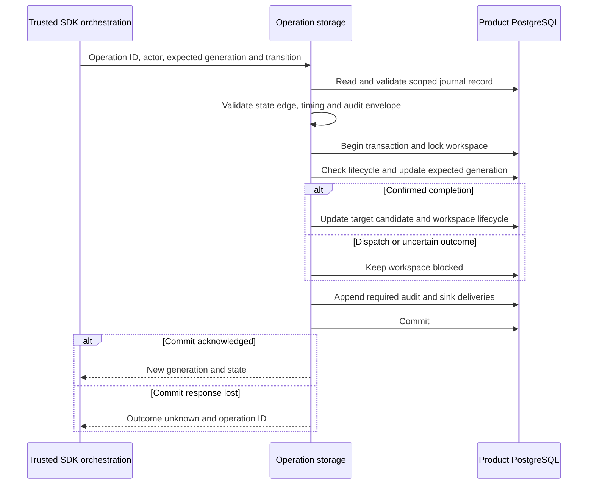

Both SDKs now persist the agreed operation state transitions with generation checks,
workspace lifecycle gates and required audit. Confirmed completion updates membership
candidates and the workspace in the same transaction. These internal storage methods
do not call OpenFGA or verify remote outcomes.

## Invariants implemented

- Every edge increments generation once. Only dispatch increments dispatch count.
  Stale workers and invalid state edges conflict; counters cannot overflow.
- Reads are actor/product/environment scoped and validate immutable payload and model
  bindings before a transition. The transaction locks the workspace before updating
  the operation, preserving one lock order for future managed writers.
- Pending creation remains inaccessible. Dispatch on an existing workspace requires
  active lifecycle. Completion preserves existing suspension, and tombstones cannot
  be reactivated. Cancellation before any dispatch tombstones a pending creation.
- Uncertain has no outgoing transition. No timeout, lease or relationship reread can
  release its block. A lost dispatch COMMIT response must not trigger a remote call.
- Completion requires confirmed state and atomically adds/updates or removes the
  target candidate. Upserts retain pagination position, allocate a new revision,
  and reject principal mismatch or a newer existing observation. Ownership transfer
  preserves the former owner's membership candidate.
- Audit/outbox failure rolls back the operation, workspace and candidate together.
  Audit actions distinguish remote confirmation from local completion. A COMMIT
  response loss returns outcome_unknown with the operation ID, never a false rollback.

## Evidence

Local PostgreSQL 17.11 run `90a66983949e4d32bf9062329e2ab731` passed the complete
managed integration harness. New shared scenarios cover successful completion,
pre-dispatch failure/retry, definitive rejection/retry, cancellation, forbidden
edges and the absorbing uncertain state. Both SDKs passed:

- Eight concurrent dispatch contenders: one generation advance, one dispatch count
  increment and one committed attempt audit; seven conflicts.
- Wrong actor, stale generation, premature retry and generation exhaustion refusal.
- Audit collision after dispatch changes and after completion/candidate insertion:
  rollback retains the original journal, block and candidate state.
- Confirmed COMMIT-response loss: dispatch remains durable and blocked, the caller
  receives outcome_unknown, and a stale retry cannot dispatch again.
- Reciprocal TS/Go reads of completed records.
- Add, assign, remove and ownership-transfer candidate completion; stable positions,
  preserved source membership, suspended lifecycle and tombstone refusal; conflicting
  candidate principal/newer observations roll back completion.

The shared fixture is `contracts/fixtures/operation-transitions.json`; the detailed
storage contract is `contracts/managed-operations.md`. Run
`python3 tests/integration/managed-schema.py` in the configured pnpm environment.
Both immutable migration checksums remain unchanged.

Membership tests seed valid confirmed records using administrative SQL. They verify
local persistence, not remote confirmation, role delegation or last-owner protection.
Runtime orchestration must still verify those facts before invoking these methods.
Candidate pagination/rebuilds, membership intent creation, recovery scanning and
operational foundations remain open. Phase 3 stays active under
[[phase-3-readiness-audit]]. Railway publication deploys these docs; the new storage
fault tests run against disposable local PostgreSQL.
