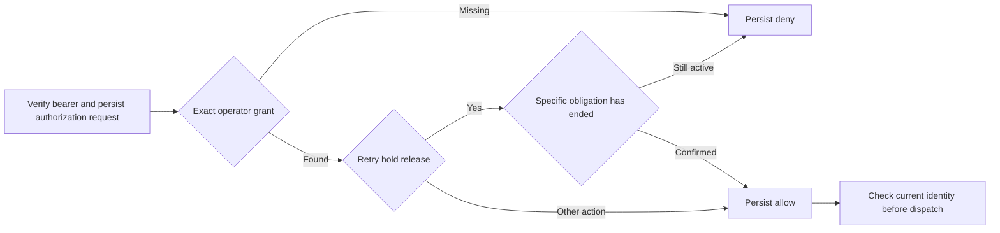

Both SDKs can build an operator policy from trusted deployment configuration.
Each grant names an issuer, subject, action and exact tenant. The policy also
matches product, environment and policy version. Null scope covers only the
product-level operation specified by the grant. For managed workspace export,
this permits whole-product inventory. Exporting operations requires a named
workspace.

The SDK snapshots the grants during construction. Operators deploy the policy
version with the corresponding identity configuration. A retry hold release
also checks evidence supplied by the product for the exact hold and target.
The policy reports an unavailable dependency through the existing audited
decision path. Product scheduling and the evidence source remain deployment
integrations.

Shared fixtures cover issuer and subject equality, exact scope and version,
configuration snapshots, invalid grants, and active, ended or unavailable
retry obligations. Pinned PostgreSQL run
`heimdall-capacity-backfill-42b47748502e4475bd2403a8cefed7ae`
used these policies in both SDKs' bound maintenance commands and sanitized
export runners. The commands denied cross-tenant access and retry hold release
without matching evidence. The same policy granted authorized releases,
retirement and the named-workspace export.
