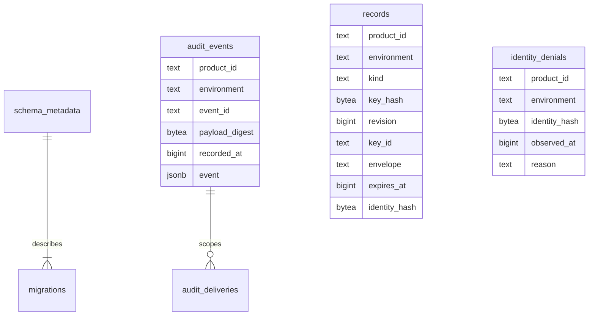

The first shared physical migration is contracts/persistence/session/0001.sql. Its exact SQL bytes are pinned by checksum in contracts/persistence/catalog.json, and both language test suites validate those bytes against the storage compatibility contract. This begins #52 and the persistence part of #46; neither adapter nor Phase 3 is complete.

## Tables and ownership

The metadata/ledger relationship above is validated by readiness logic, not a physical foreign key. Event-to-delivery scope is enforced by a composite foreign key. The session composition creates exactly six tables: schema_metadata, migrations, records, identity_denials, audit_events and audit_deliveries. No managed-workspace, operation or candidate-index table is installed.

Records distinguish session and login kinds and bind keys to product/environment. A database trigger issues a new non-cycling bigint revision on every insert/update, ignoring caller-supplied revisions. A runtime credential with sequence USAGE but no UPDATE cannot reset it. Revisions cross the language boundary as exact decimal strings. Expiry/CAS predicates must be present in adapter queries; expiry is not a database TTL.

Runtime privileges in the probe permit scoped storage operations but deny schema creation, migration writes, sequence reset, and audit event updates/deletes. Retention will use a separately authorized path. This is a trusted-backend deployment boundary, not row-level isolation from a compromised backend sharing database credentials.

## Railway proof

Run 40af844100aa4a1c97507ef53f83b4b8 used a fresh, disposable application database on the existing pinned PostgreSQL 17.11 verification cluster. It did not install tables in ZITADEL or OpenFGA databases. The migration, ledger and compatible metadata committed in one deployment transaction. A temporary NOLOGIN role was used through SET ROLE to test runtime privileges.

| Assertion | Observed result |
| --- | --- |
| Same key across products, environments and session/login kinds | Distinct rows; wrong-scope update matched zero |
| CAS with current revision | One update with a higher database-issued revision |
| Stale CAS and exact expiry boundary | Zero updated rows |
| Delete/recreate with old revision supplied | New revision greater than the deleted record |
| Two concurrent connections using one expected revision | Exactly one update winner |
| Audit insertion followed by invalid cross-product delivery | Foreign-key rejection; audit insertion rolled back |
| Successful audit plus delivery transaction | Both visible from another connection after commit |
| Event envelope scope mismatch | Check constraint rejected it |
| Delivered status without acknowledgement timestamp | Check constraint rejected it |
| Runtime privilege checks and actual DDL attempt | DDL, ledger mutation, audit mutation/deletion and sequence reset unavailable |
| Cleanup | Owned application database and runtime role deleted |

Sanitized evidence: tests/integration/evidence/persistence-schema-2026-11-11.json. The opt-in probe is tests/integration/persistence-schema-railway.py --execute-verification-persistence. It pins the verification project/environment/service and requires the existing authenticated Railway CLI and SSH identity. All fault/test state is confined to its randomly named application database and role.

## Remaining implementation proof

This proves SQL constraints, transaction rollback and concurrent update predicates. It does not prove production durability under crash/restore, a deployable migration runner, migration races, encrypted TS/Go adapter reads/writes, receipt idempotency, lifecycle reactivation, cleanup/retention, or managed recovery. Test envelopes and audit payloads are intentionally synthetic; full schema validation and authenticated encryption are mandatory in the adapters. No production session was created.

The migration is now an immutable history artifact. Later schema changes must use new numbered SQL and compatibility tests. Runtime constructors must never migrate. Phase 3 remains open while shared drivers, operations and readiness are implemented.
