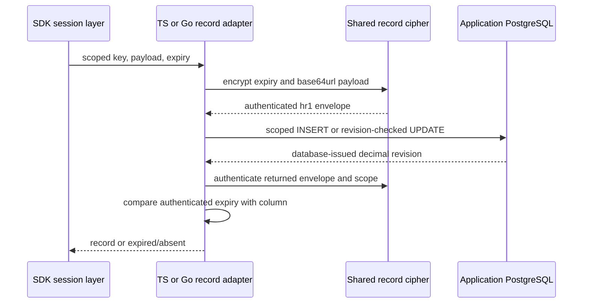

Internal TS and Go record adapters now implement create, read, compare-and-swap and delete against the [[phase-3-persistence-schema|shared schema]]. This advances #52; it does not complete the session adapter or Phase 3.

The indexed key is SHA-256 of an opaque ASCII key; the same digest in hex binds the encrypted envelope to its record key. Product, environment and session/login kind also enter associated data. Expiry is encrypted with the payload and checked against the database column. Altering the column cannot extend a session. Payloads still require session/login schema validation above this primitive.

Caller-owned pools use pg 8.23.1 in TypeScript and lib/pq 1.12.3 in Go. These releases satisfy the workspace's 30-day age rule and preserve Go 1.24 compatibility. No constructor performs migrations or exports a placeholder public API.

## Observed proof

Disposable local PostgreSQL 17.11 run `heimdall-records-b931ed24a19e4b75b681447413e4eaf5` passed on November 11. The image uses the same digest as the Railway schema probe. The test container and database were removed afterward.

| Test | Result |
| --- | --- |
| Actual TS write → Go read; Go write → TS read | Same Unicode payload and authenticated expiry |
| Eight concurrent CAS attempts per language | Exactly one winner |
| Duplicate create | Conflict |
| Wrong product and expired read | Absent |
| Delete/recreate | Fresh revision; old revision never reused |
| Tampered indexed expiry | Unavailable; no plaintext returned |
| Already cancelled call | Cancelled before query |
| Dispatched write blocked by database table lock, then cancelled | Outcome unknown |
| Read after cancelled write | Pool remains usable |

The harness is `tests/integration/postgres-records.py`; both suites consume `contracts/fixtures/postgres-records.json`. Regular tests skip the live cases without an explicit test database. The harness runs writer and reader passes with Go's race detector. This is local driver interoperability evidence; the prior schema evidence separately tested Railway permissions and transactions.

## Cancellation and remaining work

Calls have a five-second upper deadline. Cancellation before dispatch is distinguished from interruption after a write may execute. Dispatched write failures conservatively return outcome_unknown, with no automatic retry; closing a connection does not prove rollback. Unique-constraint rejection is a known conflict. Reads fail closed. TS destroys the checked-out connection on cancellation; Go passes context cancellation to the driver.

Readiness/migration execution, session schemas and lifecycle, identity-denial transactions, durable audit/outbox, pool construction and HTTP wiring remain to be implemented. These internal operations are not yet an authenticated session API. Railway hosts these docs and the separately verified schema; SDK code remains embedded in product processes, with no wrapper service.
