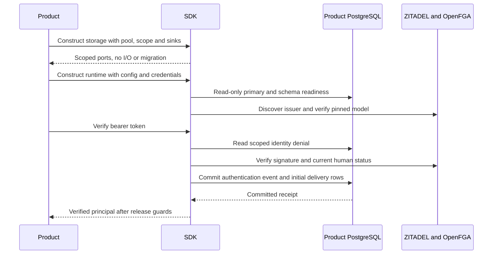
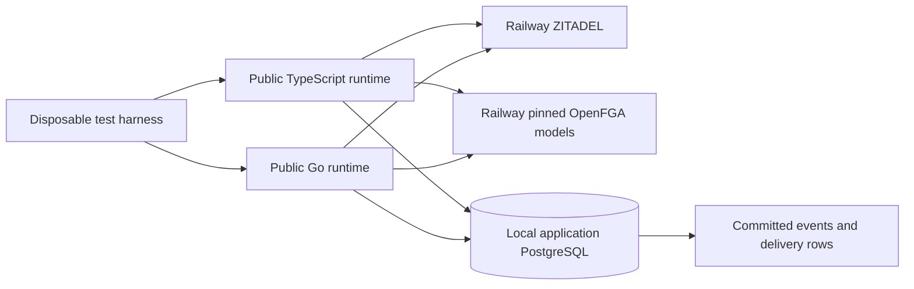
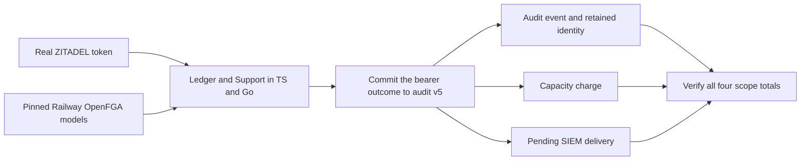

Both development SDKs now supply the durable storage bundle required by the
[[phase-3-public-runtime|public audited bearer runtime]]. Products supply their
existing PostgreSQL pool, fixed product/environment and explicit audit sink IDs.
They no longer implement readiness, identity gate or audit append callbacks for
this composition. This is Phase 3 progress, not first-release qualification.



## Developer wiring

```ts
import { createHeimdall } from "@heimdall/sdk";
import { createPostgresStorage } from "@heimdall/sdk/postgres";

const storage = createPostgresStorage(pool, {
  productId: "ledger", environment: "production", auditSinks: ["siem"],
});
const h = await createHeimdall(configJSON, manifestJSON, {
  policyVersion: "identity-v1",
  credentials: { clientSecret: loadClientSecret, openfgaKey: loadOpenFGAKey },
  storage,
}, { signal: startupSignal });
const actor = await h.tokens.verify(accessToken, { signal: request.signal });
```

```go
import (
    heimdall "github.com/techsavvyash/heimdall/sdk/go"
    "github.com/techsavvyash/heimdall/sdk/go/postgres"
)

storage, err := postgres.NewStorage(db, postgres.StorageOptions{
    ProductID: "ledger", Environment: "production", AuditSinks: []string{"siem"},
})
if err != nil { return err }
h, err := heimdall.New(ctx, configJSON, manifestJSON, heimdall.Options{
    PolicyVersion: "identity-v1",
    Credentials: heimdall.Credentials{ClientSecret: loadClientSecret, OpenFGAKey: loadOpenFGAKey},
    Storage: storage,
})
if err != nil { return err }
actor, err := h.Tokens().Verify(request.Context(), accessToken)
```

Pool construction, TLS/connection limits, explicit migration, credentials and pool
shutdown remain product responsibilities. The existing migration command installs
the immutable session-v1 schema before startup. No encryption key is needed for
bearer-only storage. Full sessions still require encryption and lifecycle wiring.

| Responsibility | Owner |
| --- | --- |
| Pool, migration and credential provisioning | Product deployment |
| Primary/schema/checksum readiness | SDK |
| Durable identity denial and exact-session invalidation | SDK |
| Event shape and SDK-event semantic validation | SDK |
| Atomic event/outbox append and committed receipt | SDK |
| Explicit initial sink identifiers | Product configuration |
| SIEM transport and delivery scheduling | Pending SDK delivery API plus product scheduler |
| Tenant business predicates and business transactions | Product |

The runtime role needs schema USAGE; SELECT on schema_metadata, migrations,
identity_denials, records, audit_events and audit_deliveries; INSERT/UPDATE on
identity_denials; DELETE on records; and INSERT on audit_events/audit_deliveries.
No schema-changing privileges or audit UPDATE/DELETE are needed. Readiness checks
schema/primary compatibility, not every privilege or future permission change.
Storage operations fail closed when required access fails. Scope is an application
boundary among trusted backends, not database isolation from a hostile process.

Sink lists are captured at construction. An empty list stores events with no
delivery rows. A sink name does not configure a transport or establish SIEM
compliance. Existing event routing is immutable. This factory validates mandatory
SDK events; custom event registration is still pending. Callbacks are trusted
backend ports, not public endpoints accepting user-provided actor assertions.

## Evidence and limits

Pinned PostgreSQL 17.11 run `heimdall-records-7ef1a6504e9b402e9cc2a5c687ec3929`
passed the complete storage/fault harness. New TS/Go tests use the exported runtime
and factory with a restricted role, actual PostgreSQL and fixture identity/model
services. Each language verifies active authentication, malformed-token refusal
and persistent denial of a warm verifier, yielding three committed events and
three initial SIEM rows. Mutating the original sink array does not reroute events.
Invalid audit shapes are rejected. Closing the caller-owned pool prevents runtime
startup. Factory construction opens no connection.

Shared `postgres-runtime.json` covers valid routing, invalid scope and duplicate,
empty or malformed sink IDs. Existing storage regression tests continue to cover
cross-language formats, transaction rollback, races and confirmed COMMIT-response
loss. Those fault tests exercise the reused storage implementations, not a new
full public-runtime fault matrix.

The packed TypeScript consumer gate now installs the tarball and its dependencies
in a fresh temporary workspace (preferring cached packages) with the 30-day release-age rule. It checks
core and PostgreSQL imports/declarations and rejects forged principal types.
The package remains private during development. This is not a final platform or
runtime support matrix.

The full workspace gate passed 1,258 TypeScript tests (27 optional live tests
skipped), Go race tests, formatting/lint/types/Knip and SDK builds. The updated
docs build validates 116 Mermaid diagrams across 80 pages.

Machine-readable storage evidence is committed at
`tests/integration/evidence/public-postgres-runtime-2026-11-11.json`. The earlier
Railway provider proof used recording storage; this checkpoint uses actual storage
with fixture services. A combined live-provider/durable-storage run remains open.
Sessions, public authorization, managed lifecycle, backpressure, custom audit and
SIEM delivery remain required release work. Phase 3 remains open.


## Combined live-provider and durable-storage proof

Run `482f31b4-681a-4f70-8ad6-25307258d971`, observed
`2026-11-11T12:55:10.217Z`, exercised both public SDKs for both Ledger and Support
against the existing Railway ZITADEL and OpenFGA verification services. Storage
was disposable local PostgreSQL 17.11 using the restricted public-runtime role,
not recording callbacks. The database was an application database, separate from
both services' internal databases. Each language used its own verification
environment within each product.



For all four product/language combinations, startup checked storage readiness,
issuer discovery and the exact pinned model. A real issued token authenticated its
expected human. A malformed token was denied and audited. The test then applied
an explicit local identity-denial observation through the storage gate; verifying
the same token was denied despite the positive cache. It decoded persisted event
envelopes and checked scope, one succeeded outcome, two denied outcomes and three
SIEM delivery rows. This denial step proves the local gate, not a SCIM worker or
provider-to-product fan-out implementation.

The encompassing PostgreSQL run
`heimdall-records-44877030c76d4a2c8214162d59b4afc9` also passed the complete existing
storage/fault harness. The OIDC probe removed its temporary organization, sessions
and OpenFGA stores; the harness removed its disposable database container. Tests
receive secrets via environment, suppress child assertions on failure, and publish
only sanitized service observations. Evidence is committed in
`tests/integration/evidence/durable-live-runtime-2026-11-11.json`.

Reproduce with the existing verification issuer, bootstrap/login credentials and
OpenFGA endpoint/key set in the environment, then run
`HEIMDALL_PROBE_DURABLE_RUNTIME=1 python3 tests/integration/postgres-records.py`
under the repository Node/pnpm/Go toolchain. Without that flag, the local storage
suite requires no external service credentials. The ordinary full gate passes
1,258 TS tests and skips 28 optional live cases; this separate run executes the
new durable live cases.

This closes the combined provider/storage evidence gap described above. It does
not deploy a product backend, exercise browser session routes, establish SIEM
transport compatibility, or complete Phase 3. See [[phase-3-readiness-audit]] for
remaining requirements.

## Audit v5 accounting with live providers

The combined probe now explicitly migrates its application database to audit v5
before running the live bearer tests. Both SDKs still use the restricted runtime
role. The harness independently joins each committed event to its compact
identity, charged bytes and pending SIEM delivery, then compares database-wide
counter deltas with the committed rows for all four product and SDK scopes.



The probe uses disposable local PostgreSQL and the existing Railway provider
services. The local identity invalidation tests the SDK's warm-cache denial
path. SCIM processing, SIEM transport and deployed product routes remain
separate acceptance work.

Run `73dbee26-1946-49e7-b5ee-53491f639bfb` verified 12 events, 12 compact
identities, 12 pending deliveries and 10,793 charged envelope bytes. Each
product and language pair contributed one success and two denials. ZITADEL
deployment `7ef5c76d-4911-4326-97dc-50d5614f2a55` and OpenFGA deployment
`cfd87a9f-da43-493c-b659-72ce4a5ba98e` served the verification run. The
sanitized record is
`tests/integration/evidence/durable-live-runtime-v5-2026-11-13.json`.
