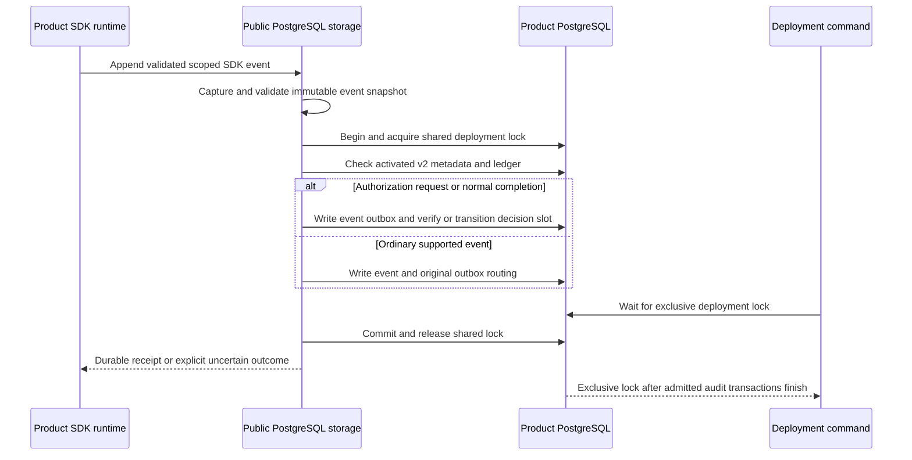

Both public PostgreSQL storage factories now require activated audit v2. Their
public audit port writes authorization events and decision slots atomically;
ordinary authentication events remain normal audit/outbox records. This closes
the public factory-selection gap from [[phase-3-audit-activation]]. The public
Heimdall client still exposes bearer authentication only, not tenant authorization.

## Transaction and deployment data flow

The v2 check is inside every public audit transaction, including exact retries.
Previously passing startup does not cache admission. If a coordinated transition
publishes migrating/incompatible state, later public audit calls fail without new
rows. The append retains its five-second budget. A pre-COMMIT cancellation rolls
back; an uncertain COMMIT is inspected through an exact retry.

Outcome_unknown authorization completion is rejected by this ordinary append port;
it needs the separate recovery administration pair. Stored actor fields are not
proof of authentication: the SDK/product integration remains responsible for
verified actors and origin. The new routing does not expose a permission API.

## Setup and privilege changes

Initialize session v1, prepare the offline upgrade, finish backfill, and explicitly
activate v2 before starting these factories. An empty new database can activate
after preparation without historical work. Existing installations must stop and
drain writers/jobs/retention throughout the upgrade. There is no runtime DDL.

Runtime needs SELECT/INSERT/UPDATE on decision slots in addition to the documented
identity and audit privileges. It receives no slot DELETE, event UPDATE/DELETE,
metadata writes or schema creation. The ordinary SDK owns neither the pool nor
its shutdown. See the repository contract `contracts/core-runtime.md` for grants.

Managed initialization now accepts recognized ready audit v1 or v2. The explicit
`--status managed-v2` command and matching internal TS/Go checker observe audit v2
and managed v1 in one primary snapshot. Legacy session/managed status modes retain
v1 semantics for migration diagnostics; public factory readiness uses audit v2.
Migration checks the connection's read-only mode before starting a read/write
transaction, so driver transaction settings cannot silently override that refusal.

## Executed evidence

`tests/integration/public-runtime-v2.py` passed on PostgreSQL 17.11, pinned image
`sha256:3540c0362c809df084ffac0ae69fe794515f9de92692f02178bcdce0ef0302ac`.
Run: `heimdall-factory-v2-ce33879f13b0446ab2f46cd0828e17cb`.

- Both public factories accept activated v2 and reject v1/migrating storage for
  startup and direct audit writes, leaving blocked databases empty.
- An already-constructed factory refuses writes after migrating state is published;
  restoring ready state permits retry and connection reuse.
- Restricted-role requests/completions persist exactly two slots per language.
  Conflicting/orphan completions and recovery-only unknown outcomes are refused.
- Injected outbox failure rolls back the attempted event and slot; no partial
  audit receipt escapes.
- Runtime attempts to modify metadata/history, delete slots or create schema
  objects fail with permission errors.
- Exclusive deployment-lock waits are cancellable in both SDKs; the pool remains
  usable. TS and Go replay one another's event/slot receipts.
- COMMIT-response loss after a public request leaves the committed slot and event;
  both SDKs recover through exact retry without duplicates.
- Both languages agree on combined audit-v2/managed-v1 compatibility cases.
  Managed initialization after activation and explicit status pass; read-only
  migration is refused.

The complete legacy persistence/bearer-runtime regression passed as
`heimdall-records-87b852f3e5164c499bcf88b32b2f5190`. Its public runtime runs on a
separate explicitly activated v2 database, while legacy v1 storage/migration
matrices keep their original database. It covers durable authentication receipts,
identity denial, encrypted record/CAS behavior, receipt rollback and COMMIT loss.
The managed-storage regression also passed as
`a069ef15d90a4b4cad284f0c4831c0fb`, preserving lifecycle/quarantine storage,
transaction rollback, cross-language reads and deployment retry behavior.

The full workspace gate passed with 1,534 TypeScript tests, Go race tests,
format/lint/type/dependency checks, SDK/package-consumer verification, Quartz
build and 142 Mermaid parses.

## Remaining scope

Shared audit admission coordinates cooperating deployment commands and these
public audit writes. It does not fence identity/session writes, direct SQL,
old processes or dispatched remote operations. External drain and managed
uncertain-write quarantine remain mandatory.

Public sessions, permission APIs, managed lifecycle orchestration and enterprise
work remain later phases. Phase 3 still needs capacity/retention, deployment-wide
key usage and operational qualification. Activation scale and maintenance-worker
integration remain open. [[phase-3-readiness-audit]] is still incomplete.
