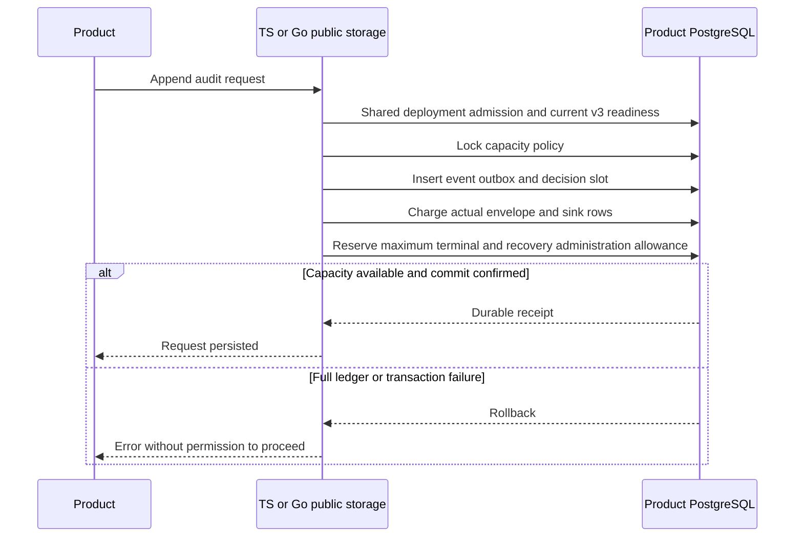

Both public PostgreSQL storage factories now require activated capacity v3.
Every public audit append checks current compatibility inside its transaction,
including exact receipt retries. Authentication audit and authorization audit
both consume the database-wide capacity budget. This completes public capacity
composition, not Phase 3 or product release qualification.

A request reserves two future events, 3000000 encoded bytes and 64 deliveries.
Normal completion consumes its actual event and releases that reservation in the
same transaction. A full ledger therefore blocks new work while preserving the
reserved terminal path. Exact retries verify the original event, routing and
reservation without charging again. Uncertain COMMIT remains `outcome_unknown`.
Outcome-unknown authorization terminals still require the internal recovery pair;
they cannot be appended through the ordinary public port.

Runtime roles receive SELECT on compatibility/preparation/checkpoint metadata,
SELECT/INSERT on charges, SELECT/INSERT/UPDATE on reservations and UPDATE on only
the six derived policy counters. They cannot change limits, receipts or schemas,
delete accounting/history, or directly modify counters through the guard trigger.
The exact integration grants are documented in the core runtime contract and
exercised with restricted roles. Public factories reject v1, v2 and migrating
storage without changing history.

## Proof

- The capacity backfill integration now invokes both public factories against a
  real activated ledger. Requests fill a deliberately reduced budget; duplicate
  requests are stable, new ordinary events fail, and completion succeeds using
  its reserved space. Counts prove two events and two charges per language.
  Mutating compatibility after startup prevents exact completion retries.
- `tests/integration/public-runtime-v3.py` upgrades the former v2 factory suite.
  It retains legacy v2 managed-readiness regression coverage on a separate
  database. Public v3 tests cover restricted privileges, full charge/reservation
  coverage, cross-language replay, atomic outbox failure, malformed/conflicting
  events, deployment-lock cancellation, and confirmed request COMMIT loss in
  both SDKs.
- The full `postgres-records.py` persistence regression uses activated v3 for
  public bearer storage and preserves separate legacy storage test databases.
  Authentication audit, warm-cache identity denial, sessions, encryption usage,
  delivery state and cross-language records remain covered.

Verified runs on November 12, 2026:

- Capacity/public admission: `heimdall-capacity-backfill-bb6f6a09a92147f487e78655ac8ffe9b`.
- Final public factory suite: `heimdall-factory-v3-fc91661362084a3d98dc61602effb0b2`.
- Persistence regression: `heimdall-records-f4f8e5af953742159faa516eede05fd8`.

All test databases were disposable pinned PostgreSQL 17.11 containers and were removed. The workspace
gate includes uncached Go race tests, TypeScript tests, packed consumer validation,
Quartz build and Mermaid parsing.

Recovery scheduling, authorized retention, managed-mutation reservations and
large-history/restore qualification remain open in [[phase-3-readiness-audit]].
This upgrade coordinates audit writers through the deployment lock; operators
must still externally stop other writers and maintenance during upgrade.
