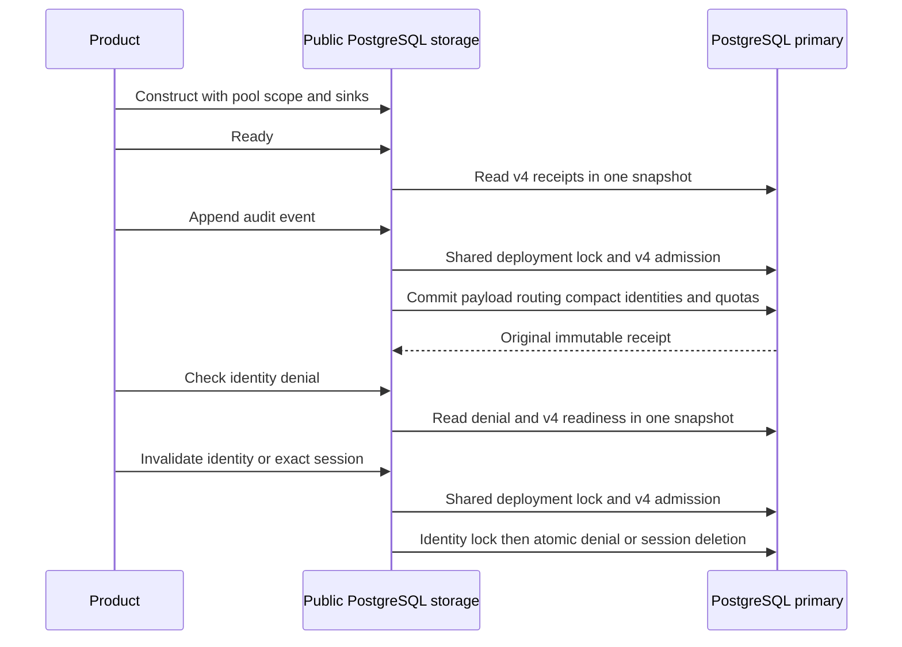

The public TypeScript `createPostgresStorage` and Go `postgres.NewStorage`
compositions now require activated audit v4. Their audit append port persists
payloads, routing, compact retry identities and capacity accounting atomically.
Their identity storage operations use the same deployment compatibility boundary.
Constructors still perform no I/O, migration or background work.

## Compatibility and deployment

Operators explicitly initialize session v1, prepare and activate decision v2,
prepare/backfill/activate capacity v3, then prepare/backfill/activate retention v4.
Use `--status audit-v4` for public bearer storage and `--status managed-v4` for
combined audit-v4/managed-v1 readiness. Managed-schema initialization now recognizes
v4 as well as the historical supported base versions. It refuses partial retention
installation and migrating state instead of falling back to v3.

Public v4 factories reject v1, v2, v3, migrating and read-only storage. Old v3
writers reject activated v4. Writers and maintenance must be drained across the
upgrade; constructors do not choose a legacy fallback or run migrations. Successful
startup is not cached permission to write after deployment state changes.

The runtime role additionally needs retention schema USAGE, SELECT on its receipt,
quota, identity, hold and marker tables, INSERT/UPDATE on compact event/decision
identities, and UPDATE on only used/reserved metadata counters. It receives no
identity DELETE, hold/marker writes, quota-limit updates or schema DDL. Full current
grants are specified in `contracts/core-runtime.md`.

## Identity admission

A denial read observes readiness and identity state in one primary SQL statement.
Identity-wide invalidation and exact-session deletion acquire shared deployment
admission before the identity advisory lock. Their five-second bounded transactions
retain cancellation and uncertain-COMMIT behavior. Go checks primary/read-write
connection state before BEGIN, so its transaction options cannot override a
read-only deployment connection silently.

An inactive identity in one environment does not deny the same issuer/subject in
another. Token invalidation remains exact-session scoped. These are persistence
ports for trusted verifier output; this change does not make arbitrary actor claims
authenticated or expose session orchestration.

## Verification

`public-runtime-v4.py` builds real schemas through the deployment CLI and exercises
both exported factories under a restricted role. Tests cover prior-version refusal,
readiness transitions after startup, request/completion atomicity, late outbox
failure rollback, capacity and metadata coverage, permission restrictions,
cross-language exact retries and confirmed-COMMIT response loss in each language.

Shared `public-runtime-v4.json` supplies both languages' identity cases. Tests cover
legacy/migrating/read-only refusal for reads and both invalidation paths, deadline
cancellation while deployment holds its exclusive lock, unchanged denial state after
refusal, pool reuse, successful denial and environment isolation. Tests that mutate
readiness run sequentially so injected faults cannot contaminate another test.

The capacity migration suite explicitly seeds historical v3 application records
with internal legacy writers. Actual public-capacity tests run on a separate
activated v4 clone with fresh product scopes. The records suite similarly preserves
its original legacy fixture and upgrades its separate public bearer database to v4.

The broad records run exposed a socket/context timer race in the Go connector:
a socket timeout could precede context cancellation and be classified unavailable.
Timeout errors now preserve deadline-exceeded classification, including when a
shorter configured connection timeout fires first. Existing stalled-startup tests
exercise plain and TLS connections, cancellation and socket cleanup.

Pinned PostgreSQL 17.11 verification passed:

- Public factories and identity admission: `heimdall-factory-v4-82dcc2a19b2943deaa3bc22dda960283`.
- Records/session and public bearer regressions: `heimdall-records-1e1ec51d6de14d4388905b4fb8045bdb`.
- Migration, public capacity, retained recovery and retirement races: `heimdall-capacity-backfill-183cddf4f7044a54a564b12ad90aebb2`.

The complete workspace gate passed with 1661 TypeScript tests (121 live-only cases
skipped without explicit database fixtures), Go race tests, packaged-consumer checks
and Quartz. All 188 Mermaid diagrams parsed successfully. The stalled-connector
suite also passed twice with the added one-second configured-timeout regression.

## Remaining gate

This completes the public bearer-storage adoption of retained audit writes. Managed
audit composition, historical recovery inspection and maintenance still need their
v4 integration. Authorized holds and retirement, complete operational/scale proof,
custom audit registration and the later release phases remain required. Internal
session/deployment primitives keep their explicit historical profiles. No public
retention administration or purge scheduler is exposed. Phase 3 remains incomplete.
