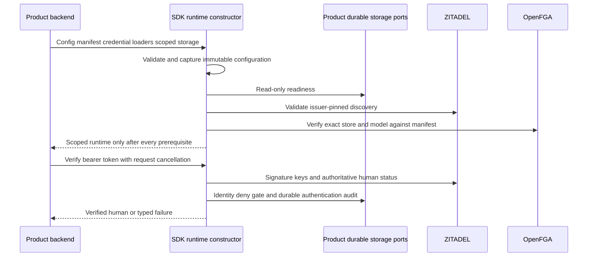

Both SDKs now expose a development core runtime for audited bearer authentication.
This is the first public composition of the implemented foundations. Phase 3 is
still active; browser sessions, tenant authorization and convenience adapter
assembly are not yet exposed, and this is not the complete first release.



## Developer wiring

The core path accepts explicit client-secret/OpenFGA-key loaders and one durable
storage bundle: fixed product/environment, read-only readiness, local identity
gate, and durable audit append. The SDK owns configuration validation, discovery,
model verification, identity verification and audit ordering. Built-in event shape
validation is bundled. PostgreSQL/managed convenience constructors are still to
come; a recording or in-memory fixture is not a valid production durable port.

```ts
const h = await createHeimdall(configJSON, manifestJSON, {
  policyVersion: 'identity-v1',
  credentials: { clientSecret: loadClientSecret, openfgaKey: loadOpenFGAKey },
  storage: durableProductStorage,
}, { signal: startupSignal })
const actor = await h.tokens.verify(accessToken, { signal: request.signal })
```

```go
h, err := heimdall.New(ctx, configJSON, manifestJSON, heimdall.Options{
    PolicyVersion: "identity-v1",
    Credentials: heimdall.Credentials{
        ClientSecret: loadClientSecret, OpenFGAKey: loadOpenFGAKey,
    },
    Storage: durableProductStorage,
})
if err != nil { return err }
actor, err := h.Tokens().Verify(request.Context(), accessToken)
```

Construction has one five-second overall budget, honors earlier cancellation, and
performs no migration or remote write. It refuses missing or cross-scope storage,
unsupported discovery, model mismatch and dependency failures. Captured callbacks
cannot be replaced by mutating options after startup begins. Caller-owned storage
must honor cancellation and uphold its durable contract.

Authentication fixes context to bearer and permits no per-request configuration
overrides. Successful identity is not a tenant grant or authorization decision.
TS freezes the facade/principal and brands the public principal type; Go keeps
principal provenance private. Stable errors and a portable audit digest helper
are public for core storage implementations.

## Proof and limits

The full gate passed 1,251 TypeScript tests, Go race tests and builds, with 26
optional TS live tests skipped. Shared startup vectors cover scope, readiness,
metadata, credentials, model and cancellation failures. Public API tests cover
real signed-token verification, audit failure, immutable captured callbacks,
invalid token audit, bounded uncooperative readiness and Go zero-client rejection.
Additional shared configuration vectors reject trailing-newline identifiers that
JavaScript end anchors previously allowed.

The TypeScript package was packed, extracted into an isolated temporary consumer
outside the repository, typechecked through its public declarations and loaded by
Node. Its branded principal rejects a fabricated object at compile time; the
packed runtime rejects malformed configuration. This is package smoke proof, not
the final clean-install/runtime compatibility matrix.

The Railway probe provisions disposable product stores/models and authenticates
Ledger and Support through the public constructors in both languages. It uses
real ZITADEL and OpenFGA, but a clearly identified recording storage fixture.
This proves public service composition and event flow, not database durability.
Separate [[phase-3-audited-authentication|PostgreSQL composition evidence]] proves
the underlying identity/audit storage path; a complete public convenience-adapter
integration remains required. All probe-created stores and organization are removed.

Sanitized live results are tracked in
`tests/integration/evidence/public-runtime-2026-11-11.json`. Enable
`HEIMDALL_PROBE_SDK_RUNTIME=1` on the OIDC harness with private verification
credentials and the pinned OpenFGA endpoint/key. The implementation contract is
`contracts/core-runtime.md`.

Verified Railway run `694badab-ff28-4926-b382-caaf15270db0` completed at
`2026-11-11T12:28:27.293Z`. Tested source is the commit containing this checkpoint,
based on `e598bb77a5453efb9c3afadc53159ca43f5a4456`.

`pnpm run check:package` now makes the isolated package smoke test part of the full
workspace gate after the SDK build. Go public API tests compile as an external
consumer package. Package installation/publication and the broader runtime support
matrix remain release-qualification work.
