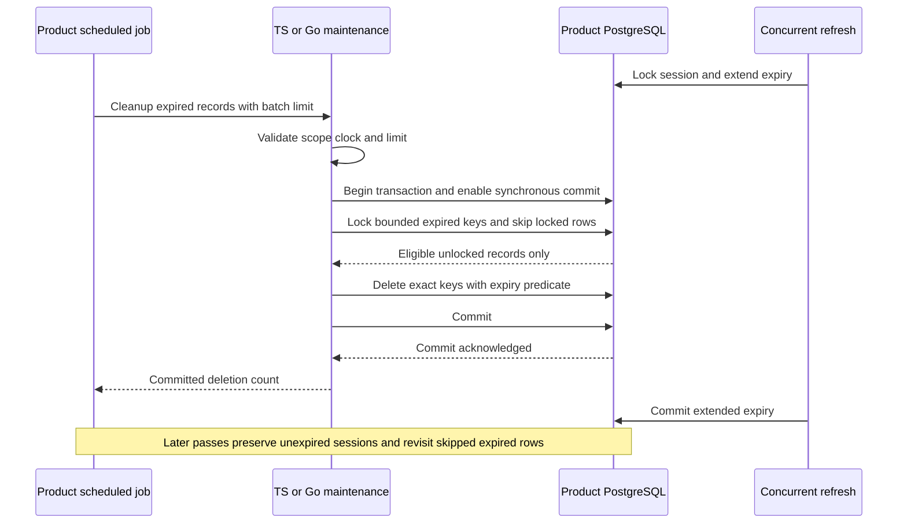

The TypeScript and Go internal PostgreSQL adapters now provide explicit bounded
cleanup of expired login and session records. This advances the storage operations
foundation; [[phase-3-readiness-audit]] remains incomplete.

## Behavior

A product-scheduled call fixes product/environment scope, samples its trusted
clock, validates a limit of 1–100, then removes only expired records in one durable
transaction. Both generic login records and identity-bound sessions are eligible.
No cipher is required and no payload is returned. Unknown commit outcomes remain
explicit errors; replay reevaluates current expiry without reviving old records.

A zero count is not proof of an empty backlog: locked rows may have been skipped.
The product schedules subsequent bounded passes. The five-second deadline bounds
connection waits and database work. Delayed physical cleanup does not extend
logical session validity. Trusted clock errors can expire sessions prematurely.

## Proof scope

Shared `contracts/fixtures/record-cleanup.json` covers before/at/after expiry,
identity-bound sessions, a separate environment and invalid batch bounds. Both
SDKs run PostgreSQL tests for:

- Exact expiry boundary, product/environment isolation, preserved active rows and
  persistent identity denials, without usable encryption keys.
- A locked refresh skipped during cleanup and preserved after extension commits.
- Eight concurrent bounded workers removing 101 expired rows with no duplicate
  deletion counts and no batch above its limit.
- Pre-cancellation, a blocked table deadline, rollback and pool reuse.
- Refusal on a read-only connection and execution under a restricted runtime role.
- Reciprocal cleanup of records created by the other language.
- A proxy that drops a confirmed COMMIT response: both SDKs return
  `outcome_unknown`, the deletions are durable, and a subsequent pass returns zero.

The disposable pinned PostgreSQL harness is `tests/integration/postgres-records.py`.
Run `heimdall-records-1292b34d26ba4534a2987c72bd3560e7` passed against pinned
PostgreSQL 17.11, including the existing session/audit/identity regression suite.
These tests use local PostgreSQL, not live browser sessions or a production
scheduler. The workspace gate passed 1,444 TypeScript tests (57 live-only tests
skipped without their configured database), Go race tests and 129 Mermaid diagrams.

The new read-only test exposed lib/pq's explicit READ WRITE transaction default.
Go now checks the selected connection's primary/read-write state before beginning
the cleanup transaction; the regression proves refusal even with no expired rows.
The deliberate table-lock fault runs separately from other TypeScript storage
suites to avoid interference with their multi-connection transactions.

## Boundaries

This call does not delete identity-denial records, audit/outbox entries, managed
workspace metadata, operation journals or candidate indexes. It is physical
expiry housekeeping, not authorization, reactivation or uncertain-write recovery.
No security event is appended for physical expiry. No timer or public session
maintenance facade is introduced. Sanitized exports, audit capacity/retention,
key-usage enforcement and full restore qualification remain required work.
