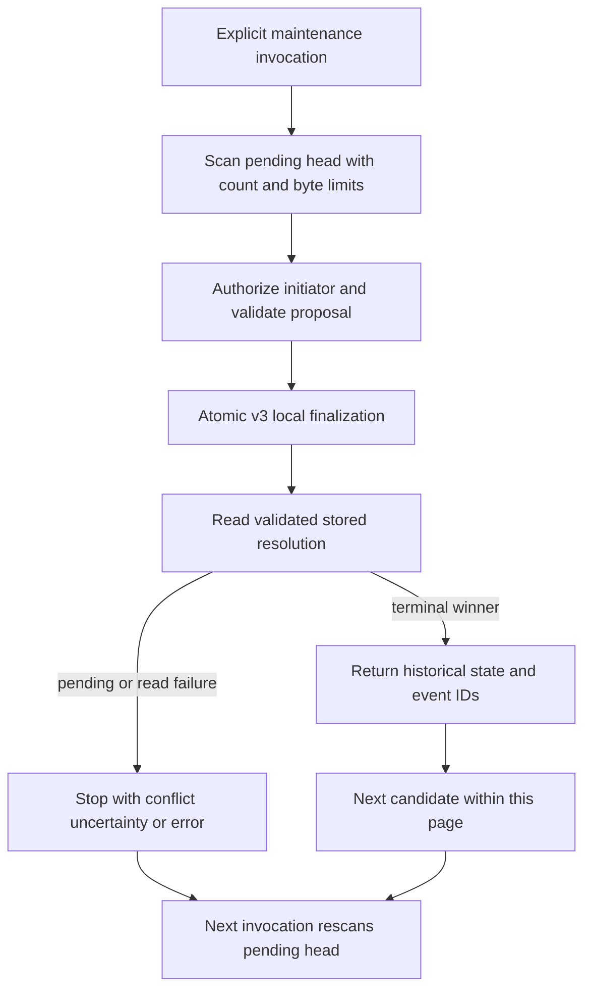

TS and Go now implement one bounded page of local audit recovery. The product
still owns scheduling and authenticating/authorizing the recovery initiator. The
internal proposal callback receives a snapshot of each validated pending request;
its result is decoded and checked against the original context and cutoff.

The immutable decision slot is the durable progress record. A committed candidate
leaves the pending queue; a failed candidate remains. Recovery and normal
completion can race, but only one terminal transition commits. After a conflict
or uncertain COMMIT response, the batch observes that winner instead of changing
its event or initiator. The result does not claim this invocation caused the
observed outcome and never releases historical authorization permission.

This supersedes the additional proposal-journal requirement introduced in
[[phase-3-recovery-proposals]] for **local audit maintenance**. Exact-pair retries
remain immutable. Caller-owned workflows needing a stable proposal key still
persist their own intent. Managed remote mutations retain their separate durable
operation journal, quarantine and verified-quiescence requirements.

A page accepts 1–100 candidates and inherits the 4 MiB scan budget. It requests a
30-second context/abort deadline. `more` is advisory under concurrency. There is
no durable batch ID, exactly-once batch count, partial-success return on failure,
implicit timer or silent skipping of poisoned candidates. Scheduling and metrics
remain product/public-adapter work.

## Verification boundary

The shared recovery-batch fixture exercises confirmed recovery, lost-response
observation, normal-completion and competing-recovery winners, pending uncertainty,
failed observation, admission failure and missing resolution in both languages.
Focused tests also reject invalid limits and already-cancelled calls before I/O.

The initial live run exposed a single-use fault-proxy limitation and a real Go
driver startup timeout gap. It was terminated and is not passing evidence. The
revised fault harness sends only the write through that proxy and uses a separate
connection for observation. Revised pinned PostgreSQL 17.11 run
`heimdall-capacity-backfill-9ee1ed54161248d7b5b030f88c3372b9` passed and its
disposable container was removed. Both language batches recover at a full event
budget, observe the original initiator after confirmed COMMIT-response loss, and
return an empty second invocation without calling the proposer again. This is
explicit invocation/reconnection evidence, not a process-kill restart test.

The connection gap remains explicit in [[phase-3-readiness-audit]]: lib/pq startup
without `connect_timeout` can outlive the operation context. [[phase-3-go-connection-deadlines]] subsequently fixes and tests that startup
case for the SDK connector and deployment commands; arbitrary custom pools remain
the caller’s responsibility. [[phase-3-recovery-process-restart]] now proves SIGKILL between committed candidates
and restart in the other language. Other crash boundaries, retention, operational
scale and public maintenance composition remain open. Phase 3 is incomplete.
