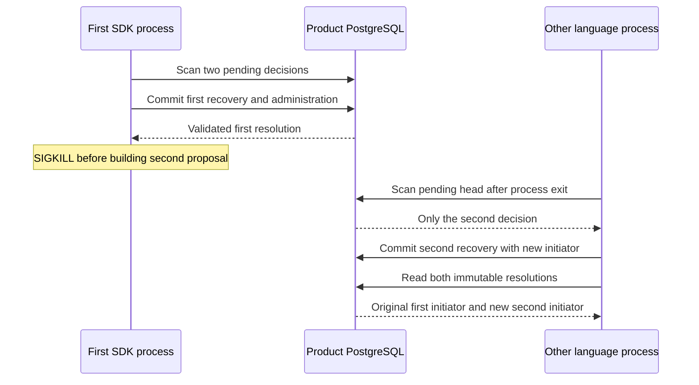

Local audit maintenance now has executed process-interruption evidence in both
language directions. A Go worker is killed with SIGKILL and TypeScript resumes;
a separate run kills TypeScript and resumes in Go. The replacement has no access
to the first process's memory or proposal objects.

## Executed proof

Pinned PostgreSQL 17.11 run
`heimdall-capacity-backfill-7acc1dc206c84395ab3913f09ff95a07` passed. The disposable
container and temporary compiled Go worker were removed. The harness verifies
actual signal termination with return code -9 for each standalone process; a
thrown exception, ordinary exit or timeout cannot satisfy that assertion.

Each isolated database starts with two requested decisions in the same scope.
The event limit is set to used plus reserved capacity. Maintenance scans both,
commits the first recovery pair and reads its resolution, then the process kills
itself at the second proposal callback before that candidate is written.

After the crash, the harness requires exactly one recovered and one pending slot,
four scoped audit events, two additional used events and two released reserved
event slots.
The other language resumes from the pending head and processes exactly one item.
It verifies both terminal IDs and administration actors: the first remains owned
by `crash-worker`; only the second belongs to `resume-worker`.

After resumption, there are exactly six scoped events, six event charges and six
outbox rows. Both slots are recovered. Used events increased by four and reserved
events decreased by four relative to the seeded pair. Another maintenance call
returns no work and never calls the proposer again. Shared fixture
`contracts/fixtures/recovery-restart.json` pins the identities and expected counts.

This supports the existing decision slot as the durable work queue: completed
work stays committed and pending work remains discoverable after process death.
It adds no runtime API, journal table or service.

## Limits

The process is killed between candidate transactions, after the first outcome has
been observed. This does not claim SIGKILL coverage at every instruction or a
crash inside a database COMMIT. Confirmed COMMIT-response loss and transactional
rollback have separate evidence. No remote write is involved, so managed mutation
quarantine and verified quiescence remain unchanged. Retention, other crash
boundaries, operational scale and public maintenance composition remain open in
[[phase-3-readiness-audit]].
