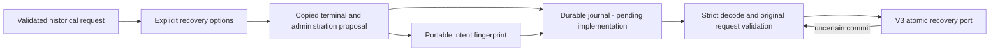

TS and Go can now build, fingerprint and reload the same recovery proposal from a
validated historical request. All IDs, timestamps, cutoff and initiator values are
explicit; rebuilding after a crash must not silently change them. This is the
executable input contract for durable recovery journaling, not a claim that the
journal or scheduler is implemented.

The proposal retains the original actor/context on the unknown authorization
terminal. The separate administration event identifies the recovery initiator.
The decoder validates full shapes, semantics, original request digest and pair
bindings, rejects unknown top-level fields and trailing JSON, and bounds input
size. It accepts equivalent JSON formatting; TS and Go use value fingerprints,
not identical serialization text. The returned proposal does not alias caller
request or actor objects.

## Verification

The shared fixture pins independently calculated request and proposal hashes and
the full expected event pair. Both languages cover valid construction/reload,
input mutation isolation, changed-history refusal, invalid times/cutoffs,
unknown initiator, invalid IDs/version, and corrupted persisted fields. A different
but valid initiator produces a different fingerprint. This permits journal
idempotency checks without treating the fingerprint as authorization.

The live PostgreSQL recovery suite now constructs and JSON-round-trips these
proposals from scanned candidates before recovery in both languages. Reciprocal
history recovery and confirmed COMMIT-response loss still pass at a full event
budget. Run `heimdall-capacity-backfill-a65bf62a16094e1bad7efa56c0244945` passed on
November 12, 2026; its disposable pinned PostgreSQL 17.11 container was removed.
The serialization round-trip is format evidence, not a disk-crash durability test.

This checkpoint originally required a separate proposal journal. That requirement
is superseded for local audit maintenance by the atomic-slot protocol in
[[phase-3-recovery-maintenance]]. Caller-owned workflows with stable proposal keys
still persist the full proposal plus fingerprint before finalization,
then reload the original proposal on restart or uncertain completion. Authorization
of its initiator, journal transactions, durable restart checkpoints, scheduling,
retention and operational qualification remain open in [[phase-3-readiness-audit]].
