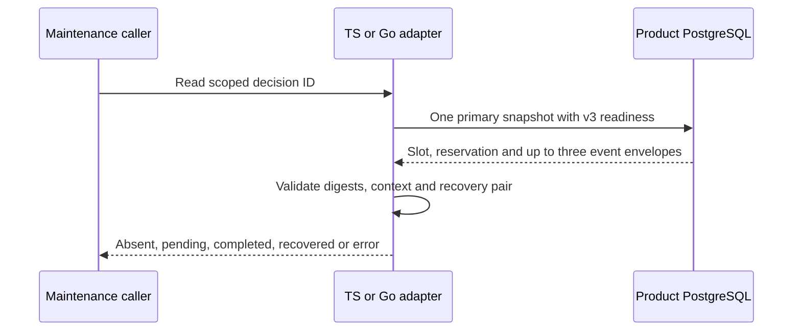

Both SDKs now expose internal read-only resolution ports. A new adapter can read
the durable winner after a recovery COMMIT response is lost, without receiving
the original in-memory proposal. This observes historical state; it grants no
permission and does not reevaluate the historical authorization request.

The reader verifies request/terminal context, indexed timestamps and reservation
references. Recovered history must contain its deterministic administration event
with valid recovery-pair bindings. Missing or corrupted required history fails
closed. It uses a five-second deadline and preserves cancellation. An absent or
pending record is never an allow; pending observation does not exclude a racing
finalizer.

## Executed evidence

The pinned PostgreSQL 17.11 integration run
`heimdall-capacity-backfill-58ed513b002d4b8c97cca0df3ae673a7` passed. Its disposable
container was removed. Both languages read the existing shared fixture's four
product/environment scopes and distinguish pending, completed and recovered
records. They also check absent decisions, an unrelated scope, cancellation,
corrupted administration digests and migration refusal.

The harness drops a confirmed recovery COMMIT response separately for each
language. A new adapter reads the original recovered terminal and initiator
before the exact-pair retry. The recovery suite still proves full-capacity
finalization, immutable receipts and late normal-completion rejection. This is
connection-fault evidence, not a process-kill or complete scheduler-restart test.

## Remaining work

These ports do not implement a public maintenance scheduler, durable proposal
journal, retention or operational qualification. The next orchestration design
must decide how proposal idempotency and restart progress compose with the
existing immutable decision slots. No change to managed remote-write quarantine
or quiescence requirements is implied. Phase 3 remains open in
[[phase-3-readiness-audit]].
