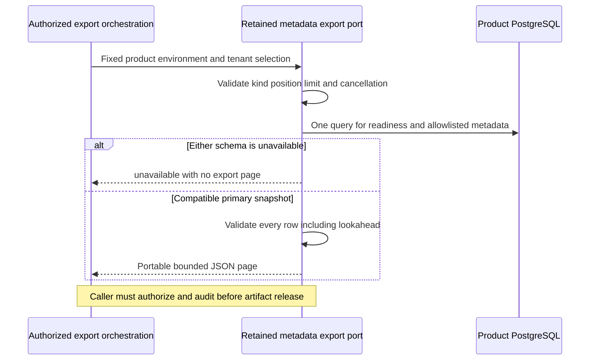

The internal sanitized managed export ports now have retained runtime factories:
TypeScript `ManagedExport.forRetainedRuntime` and Go `NewRetainedManagedExport`.
They preserve the export contract from [[phase-3-managed-export]] while requiring
audit-v4 and managed-v1 readiness in the same primary snapshot as each page.

The constructor performs no I/O. Existing legacy constructors remain explicit
migration/diagnostic ports. Retained callers cannot receive a successful empty
page when audit storage is legacy/migrating, managed metadata or its ledger is
incompatible, or the connection is read-only. No separate readiness query races
the data snapshot.

## Data and privilege boundary

Workspace and operation export still select only their explicit metadata columns.
Names, identity hashes, principals, intent payloads, fingerprints, idempotency
keys, sessions and audit payloads are excluded. All lifecycle and operation states,
including uncertainty and tombstones, remain visible. The page is neither a
restorable journal nor permission to replay remote writes.

The retained export role has column-specific SELECT on managed metadata plus
SELECT on the readiness tables: schema metadata, migration ledgers, quota policy
and upgrade/backfill receipts. It has no access to sensitive managed columns,
audit payloads or retained event identities. Readiness adds no data columns to the
export. A SELECT-only role works on a normal primary connection; a PostgreSQL
read-only transaction is intentionally refused by runtime admission.

Five-second bounds, input validation, full lookahead validation, ASCII keyset
ordering, scope filters, exact revision strings and cancellation remain unchanged.
Each page is its own snapshot. The operator must separately stop/drain writers for
a consistent inventory and retain the correct model/manifest mapping for exit.

## Verification

The shared `managed-retained-runtime.json` cases now require both export kinds to
refuse even absent tenant results under incompatible readiness and on read-only
connections. Existing export fixtures run against the activated database through
the retained factories. They check pagination across more than 100 records,
tenant/product isolation, preservation of uncertain states, exact field allowlists,
reciprocal TS/Go reads, blocked-query cancellation and subsequent connection reuse.
Explicit SELECT attempts for workspace names, intent payloads, actor hashes, audit
payloads and retained event identities must fail under the export role.

Live run `heimdall-capacity-backfill-160d210893c54156a9ee236b8f79a2e3` passed
the complete capacity/retention harness, including both retained export ports,
reciprocal reads, restricted-column refusal and readiness failures. The focused
TypeScript export rerun also passed after a lint-only test rewrite. The workspace
gate passed with 1,664 TypeScript tests (123 environment-dependent skips), Go race
tests, lint/type/build checks and 193 parsed Mermaid diagrams. The live harness
supplies the database-dependent proof separately from those workspace skips.

Reproduce with `python3 tests/integration/audit-capacity-backfill.py` using the
storage option below when needed. The historical legacy profile remains in
`tests/integration/managed-schema.py`. The disposable container and its private
host data directory were removed after the successful run.

## Test infrastructure correction

The initial attempts failed before export verification because Docker's data disk
was full. The PostgreSQL harnesses removed their disposable containers but left
anonymous data volumes behind. All affected owned-container cleanup paths now use
`docker rm --force --volumes`; a focused check verified that the associated anonymous
volume disappears. This does not prune unrelated containers, volumes or build caches.

The capacity/retention harness also waits for TCP readiness and reports bounded
PostgreSQL error text. When Docker's data disk has insufficient space, set
`HEIMDALL_TEST_POSTGRES_BIND_ROOT` to an existing private host directory. The harness
creates a unique disk-backed data directory under it and removes that directory
only after removing its own container. The verification run uses this mode with
the same pinned PostgreSQL image and unchanged SQL/test assertions. It does not use
an in-memory database or waive commit-loss, accounting or concurrency checks.

The storage port remains internal. The audited release path now authenticates
the operator and commits a matching completion before returning a page.
The inventory runner can use one snapshot for multiple pages. Complete restore
qualification remains open. [[phase-3-audited-managed-export]] ·
[[phase-3-managed-inventory]] · [[phase-3-readiness-audit]]
