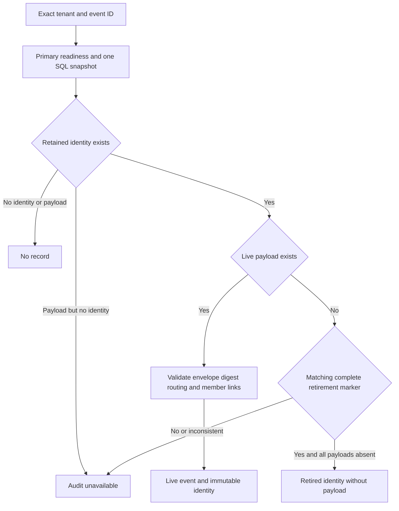

Both internal PostgreSQL adapters now inspect retained event history using one
primary snapshot. They distinguish a live event, intentional retirement, unknown
IDs and corrupt missing history without granting a new authorization decision.

The shared `retained-inspection.json` cases run in both SDKs against clones of the
live retirement test database: ordinary-event retirement, live completion,
unknown ID and another tenant. Additional cases delete an unmarked ordinary
payload, corrupt a live event digest, cancel before I/O and mark the schema as
migrating. Missing/corrupt history must fail; migration must refuse reads.

Pinned PostgreSQL 17.11 run
`heimdall-capacity-backfill-88eb4bcdda114a328159aa7bc7219b95` passed both SDK
inspection suites and the surrounding migration, capacity and recovery harness.
Its disposable container was removed. The full workspace gate passed.

These internal reads require the prepared schemas and existing v3 primary readiness.
They do not activate retention or alter public SDK APIs. The live case validates
the original event; the retired case returns metadata only and cannot reconstruct
the personal payload or an old allow result. Public payload-only reads must later
map intentional retirement to not_found after authorization. Full retired-decision
qualification, runtime receipt retries and v4 admission remain unfinished. See
[[phase-3-retirement-markers]], [[design/audit-retention]] and
[[phase-3-readiness-audit]].
