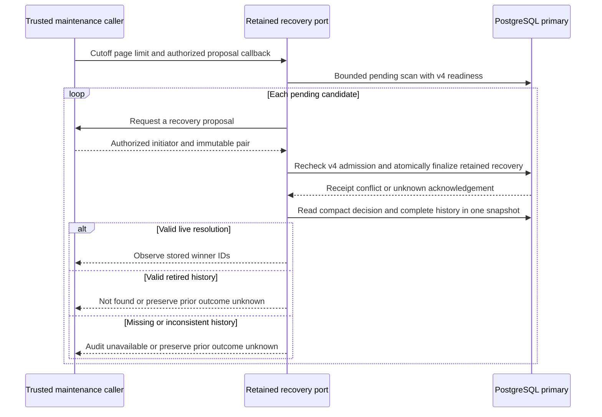

Internal recovery maintenance can now use the activated v4 retained runtime in
both SDKs. It scans the existing bounded pending queue, finalizes each recovery
through retained atomic writes, and observes the winner through retained history.
The public bearer factory remains unchanged. There is no implicit scheduler or
public administration endpoint.

## Historical resolution

`ReadRetainedResolution` / `readRetainedResolution` resolve the scoped decision
through its compact request identity. One primary SQL snapshot reads the root,
complete member group, original routing/charges, source decision/reservation
binding and retirement markers. Individual envelopes are capped at 1.5 MB; at
most three members plus the representative request are returned. Existing semantic
validation checks the entire live group before returning payload-backed history.
The operation retains a five-second bound and cancellation behavior.

The result is historical evidence, never a new authorization decision. Unknown
scoped IDs return absent. If source or event identity rows exist without a compact
decision, the reader reports `audit_unavailable`, not absence. Mixed live/retired
members, missing compact members, changed tenant links and corrupt payloads also
fail. Valid complete retirement returns `not_found`: local payload history is no
longer available, and compact receipts cannot recreate it.

This deliberately preserves the existing payload-backed resolution interface.
The reader does not fabricate actor or outcome payloads from compact metadata.
An observation failure after an uncertain write preserves `outcome_unknown`;
maintenance cannot treat unavailable history as proof the write failed or claim
a newly successful result.

## Bounded maintenance and admission

The retained runtime exposes the same internal scan/recovery/resolution interface
used by the bounded maintenance loop. Its pending scan retains the scoped cursor,
100-candidate limit and 4 MiB encoded-page budget. V4 readiness is evaluated in the
same scan statement, including empty results. Candidates remain hints: finalization
revalidates decision state and full history under shared deployment admission.
No external cursor advances past failure. Completed decisions leave the durable
pending queue, so the next invocation restarts at its head safely.

Writes reserve and consume both payload and compact metadata capacity. Normal
completion, competing recovery, cancellation and uncertain COMMIT retain the
existing semantics. The proposal callback still must authorize its initiator and
be bounded; this internal storage composition does not authenticate operators.
The retained scan/reader checks v4 receipts, while explicit legacy primitives keep
their historical deployment/test behavior.

## Verification

Shared `retained-resolution.json` covers pending, completed and recovered live
history, unknown IDs, migrating readiness, missing compact decisions/requests,
changed tenant links, missing source decisions, corrupted terminal payloads and
coordinated source/compact timestamp changes that disagree with event identities.
Both SDKs also read fully retired completed/recovered groups on prepared and
actually activated v4 databases and reject a missing retired member identity. Corruption cases run inside rolled-back test transactions.

The retained-runtime fixture includes migrating and empty-ready scans plus
resolution reads. The maintenance harness runs both SDKs on actual activated v4
clones with restricted credentials and fully reserved payload/metadata capacity.
It repeats each test with a proxy dropping a confirmed COMMIT response; a separate
healthy connection reads the stored winner. A subsequent invocation performs no
work and preserves the original initiator. Shared batch fixtures verify that
`not_found` cannot erase earlier write uncertainty.

The complete pinned PostgreSQL 17.11 suite passed in run
`heimdall-capacity-backfill-28d68808d2d54aaa9a8b35fde01742a4`, including activated-v4
retired history, both languages' capacity-full maintenance and COMMIT-loss cases,
and the existing migration/recovery/retirement regressions. Both SDKs' resolution
fixtures were additionally rerun against that activated database after adding the
coordinated timestamp-corruption cases; they passed.

The workspace gate passed with 1663 TypeScript tests (122 live-only cases skipped
without their explicit database fixtures), Go race tests, packaged-consumer checks
and Quartz. All 189 Mermaid diagrams parsed successfully.

## Remaining Phase 3 gate

Managed audit transactions still need retained v4 composition. Authorized
hold/retry lifecycle and retirement audit, bounded retention scheduling and
operational/scale qualification remain required. No payload purge is enabled by
this maintenance API, and Phase 3 remains incomplete.
