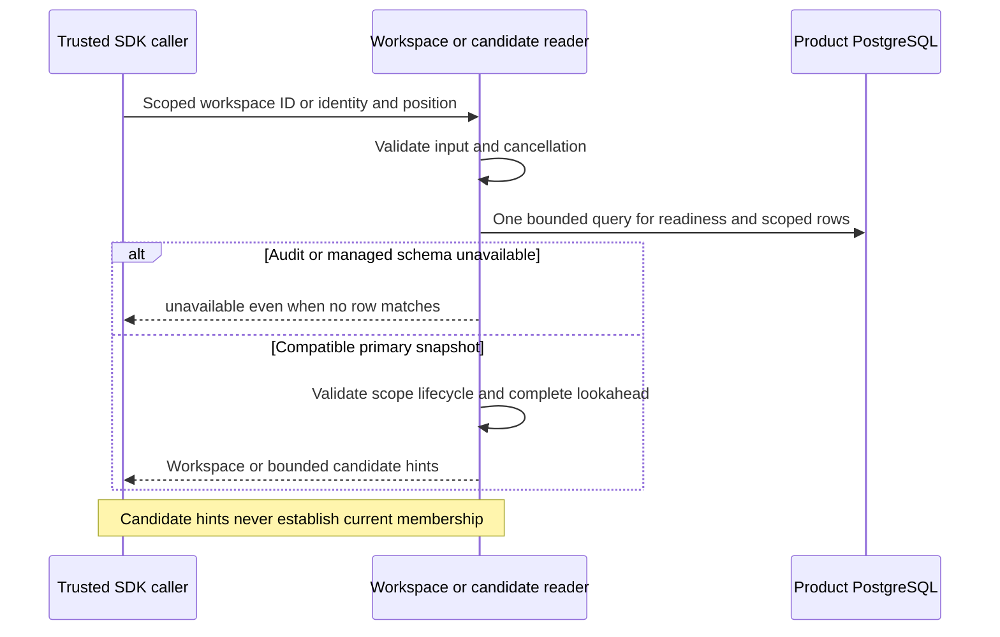

Both SDKs now provide internal retained factories for standalone workspace lookup
and candidate pagination. They add the matching read integration alongside
[[phase-3-retained-operations]], using the same audit-v4/managed-v1 readiness
predicate in the same primary SQL snapshot as the requested data.

## Runtime behavior

TypeScript uses `WorkspaceRecords.forRetainedRuntime` and
`CandidateRecords.forRetainedRuntime`; Go uses `NewRetainedWorkspaceRecords` and
`NewRetainedCandidateRecords`. Construction validates configuration without I/O.
The legacy internal constructors remain migration-test ports. Public SDK APIs do
not expose these unauthenticated storage interfaces.

The shared query helper preserves scope parameters and appends the readiness
parameters. It replaces the query's primary-status expression with combined
readiness, so even a null workspace or empty aggregate evaluates both schema
families. No separate readiness preflight can race the data snapshot.

All existing row validation remains: exact product/environment/workspace and
principal/hash binding, active and unblocked candidate filtering, strictly ordered
bigint positions, bounded lookahead, lifecycle/timestamp validity and cancellation.
Queries retain their five-second bound. They perform no writes, acquire no work
claim and cache no authorization result.

A SELECT-only role can read with the required schema/data grants while using a
normal read-write connection. A PostgreSQL read-only transaction or replica is
still refused by runtime admission. Missing readiness grants, migration state,
legacy audit versions or incompatible managed ledgers return unavailable, not
absence. Candidate results remain hints; current membership and durable decision
audit belong to the future public discovery layer.

## Verification scope

The shared `managed-retained-runtime.json` admission cases now exercise workspace
lookup and candidate scanning alongside operation reads/writes. They check absent
results under migrating/legacy audit state, migrating managed state and a wrong
managed ledger checksum, plus read-only connections.

The activated PostgreSQL profile also runs the complete existing workspace and
candidate suites through retained factories. These cover scope and principal
isolation, malformed rows, lifecycle changes, pagination and lookahead, cancellation,
large decimal positions and reciprocal language reads. Managed transition and repair
suites use the retained readers too, so their newly written state is read through
the same readiness boundary.

Pinned PostgreSQL 17.11 run
`heimdall-capacity-backfill-e727e90f9b2847aebb4568a29195d91f` passed the activated
managed profile and the full surrounding capacity/retention regression suite.
The workspace gate passed with 1,664 TypeScript tests, Go race tests and package
checks; the updated Quartz build validated all 192 Mermaid diagrams. Reproduce with
`python3 tests/integration/audit-capacity-backfill.py`; legacy migration-profile
coverage remains in `tests/integration/managed-schema.py`.

## Remaining Phase 3 work

These are storage adapters, not authenticated workspace discovery. Public discovery,
HTTP/session integration and managed orchestration remain later-phase work.
Authorized audit hold/retirement composition and operational foundation evidence
remain in [[phase-3-readiness-audit]]. Phase 3 is incomplete and Phase 4 has not
started. No purge, automatic migration or background worker is enabled.
