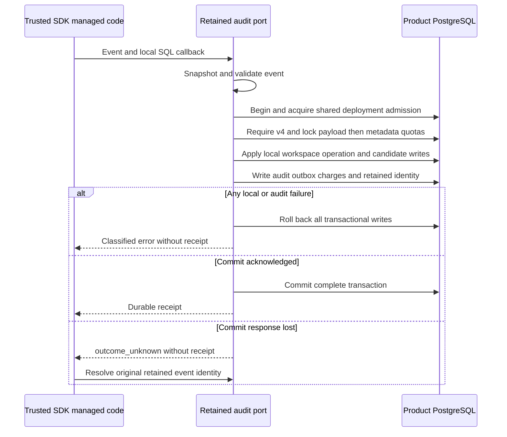

Both SDKs now have an internal transaction boundary that combines trusted managed
SQL with v4 retained audit writes. This extends the earlier
[[phase-3-managed-audit-transactions]] primitive to include payload accounting,
compact event identity and metadata accounting. It does not expose product-supplied
callbacks or complete managed operation factory integration.

## Transaction and retry rules

Go's package-private `RetainedRuntimeAudit.appendWith` and the internal TypeScript
retained port share the existing retained append implementation. Validation occurs
before acquiring a connection or invoking local SQL. The shared deployment lock
and v4 readiness precede the callback; payload and metadata quota locks retain
their existing order. Event snapshotting protects against caller mutation during
the callback. Errors preserve conflict, cancellation, unavailable,
audit_unavailable and outcome_unknown distinctions.

A callback must not perform remote I/O, commit independently or publish a result.
It must enforce durable operation-key and generation checks itself. An identical
existing audit event does not deduplicate a callback, and a retained receipt does
not authorize repeating an old operation. Recovery from lost COMMIT can inspect
or retry the original event without re-running managed SQL or changing its
original sink routing. Neither leases nor this transaction boundary establish
remote-write quiescence.

## Verification scope

The shared `managed-audit-transaction.json` matrix runs against both the original
legacy profile and an explicitly activated v4 clone. Its rows are synthetic local
storage fixtures, not authenticated onboarding requests. The v4 profile uses a
restricted runtime role with explicit managed sequence permissions and retained
write grants. It checks success, callback conflict, SQL uniqueness conflict,
changed audit payload, outbox failure, cancellation and a new late retained
identity constraint failure. Separate wire-proxy cases withhold a confirmed
COMMIT response for each language; independent reads verify the committed state,
and receipt retry preserves the original two sinks.

The harness also checks that each committed test audit event has a retained
identity and payload charge, and that metadata usage matches its persistent
identities. Nontransactional revision sequences may consume values on rollback;
no persisted managed or audit rows may survive a failed transaction.

Pinned PostgreSQL 17.11 run
`heimdall-capacity-backfill-428e61bdd1364ad0afc9c4fac1948660` passed the full
capacity/retention regression suite, including the managed transaction cases.
Independent queries against the same live clone also confirmed event-identity
counts and payload quota usage. The workspace gate passed with 1,664 TypeScript
tests, Go race tests, package checks and 190 Mermaid diagrams. Reproduce with
`python3 tests/integration/audit-capacity-backfill.py` using the repository
Node, pnpm, Go and Docker toolchain.

## Remaining work

Managed operation constructors and their reads still use the older internal
composition and must be integrated with v4 managed readiness next. The new local
transaction primitive is not a claim that all managed entry points already use
retained audit. Authorized retention/hold administration, operational qualification
and the rest of [[phase-3-readiness-audit]] remain open. Phase 3 is incomplete;
Phase 4 has not started.
