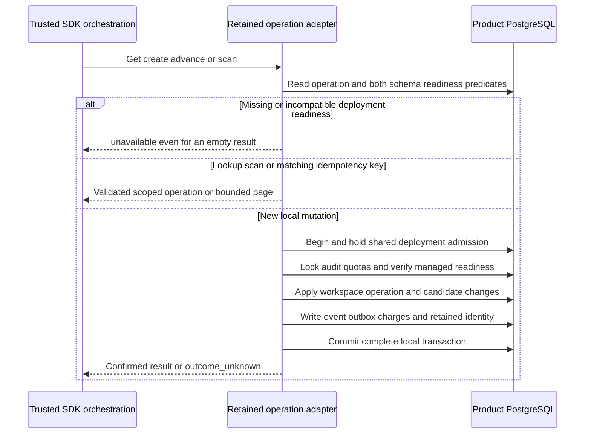

TypeScript `OperationRecords.forRetainedRuntime` and Go
`NewRetainedOperationRecords` compose the existing managed operation behavior with
audit-v4 and managed-v1 storage. Constructors perform no I/O. This is an internal
SDK adapter; product-facing managed administration and remote recovery orchestration
remain future work.

## Preserved behavior

Actor-scoped lookup and idempotency lookup evaluate readiness in the same primary
SQL snapshot as the returned record. Maintenance scans do the same for their
bounded page, including empty queues. A migrating deployment, legacy audit version,
incompatible managed ledger or read-only connection cannot masquerade as a missing
operation or empty queue.

Creation, membership reservation, all supported transitions and candidate repair
use [[phase-3-retained-managed-transactions]]. The retained writer acquires shared
deployment admission and payload/metadata quota locks before managed SQL. Under
that admission, the adapter verifies the managed schema, then preserves
workspace-before-operation/candidate locking and existing generation/revision CAS.
Required retained audit and all local changes commit together.

Same-key retries return the recorded operation without replacing its allocated IDs.
Changed payloads conflict. Lost COMMIT keeps the existing outcome_unknown behavior,
including operation IDs where applicable. An uncertain operation remains blocked;
no scan, retry or lease expiry permits a remote replay. Candidate repair still
requires fresh trusted observations and its original workspace revision.

The original internal constructors remain explicit legacy-profile test ports. New
runtime orchestration must choose the retained factories. Standalone workspace and
candidate readers still need their own v4 composition; this checkpoint does not
claim those adapters are integrated.

## Evidence scope

The shared `managed-retained-runtime.json` fixture checks audit migration/legacy
state, managed migration state and an incorrect managed ledger checksum. Both SDKs
must refuse absent lookup, empty recovery scan, create and candidate repair, then
resume valid empty reads after readiness is restored. Read-only connections are
also refused. Rejected calls leave no new operation rows.

The activated PostgreSQL profile runs the existing creation, membership-intent,
transition, candidate-repair and operation-scan suites through the retained factories.
It includes scoped model/actor checks, same-key and generation races, quarantine,
candidate completion and byte-bounded scans, followed by reciprocal language reads.
Separate confirmed-COMMIT-loss cases cover creation, transition, membership
reservation and candidate repair in each SDK. A final SQL check requires retained
identity and payload accounting for every persisted audit event in the profile.

The restricted runtime role can mutate managed rows and delete candidate hints as
required by membership removal. It cannot delete workspace/operation history or
retained identities. Administrative fixture seeding is separate from runtime calls;
these tests do not authenticate end users or call OpenFGA.

The activated operation profile passed in run
`heimdall-capacity-backfill-ef2a96902687483cbc61b4f1f8182c2c`. A focused
concurrent TS/Go create test against the same live clone converged on one workspace,
one operation, one retained event identity and two deliveries. The full surrounding
capacity/retention regression suite also passed. The workspace gate passed with
1,664 TypeScript tests, Go race tests, package checks and 191 Mermaid diagrams. Reproduce with
`python3 tests/integration/audit-capacity-backfill.py`. Historical legacy coverage
remains in `tests/integration/managed-schema.py`.

## Remaining gates

Workspace/candidate read composition, authorized hold/retirement administration,
operational qualification and the rest of [[phase-3-readiness-audit]] remain open.
Public managed APIs must still authenticate and authorize actors and establish
remote outcome evidence. The factories add no wrapper service or background worker.
Phase 3 is incomplete; Phase 4 has not started.
