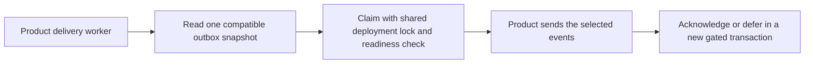
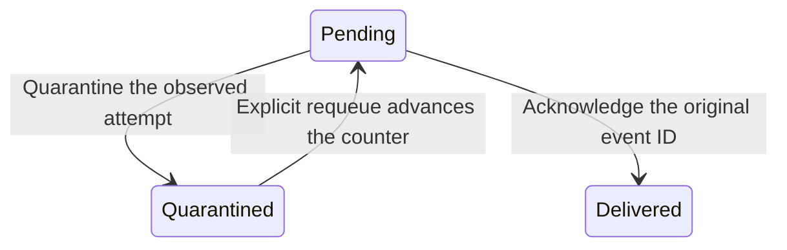

Both SDKs now expose the existing pending read, claim, defer, quarantine and
acknowledgement operations through the retained audit storage port. Pending
reads verify audit v4 or v5 compatibility in the same PostgreSQL snapshot
as the batch. Delivery mutations acquire the shared deployment lock and
verify readiness in the transaction before changing delivery rows.

The worker supplies the sink, delivery timing and authenticated transport.
The existing attempt comparisons, partial acknowledgement and uncertain commit
semantics still apply. Schema admission applies even to an empty batch or a
transition that would affect zero rows. The port has no implicit scheduler.

Pinned PostgreSQL 17.11 run
`heimdall-capacity-backfill-70a47b2848e746dbaa85fe5b0de40a7b`
exercised both languages on v4 and v5. Each SDK read its pending event, claimed
one attempt, deferred it, acknowledged the receipt and observed an empty
pending batch. PostgreSQL confirmed the final attempt, retry and delivery
timestamps. Both SDKs refused all five calls during migration and through
read-only connections.

## Explicit quarantine replay

An operator can requeue a quarantined delivery by its scope, sink, event ID and
observed attempt counter. The requeue sets the next-attempt time and advances the
counter. An earlier attempt can no longer defer or quarantine the row. The next
worker claim advances the counter again and uses the same original event ID.
An authenticated acknowledgement of that original ID can still settle a pending
delivery under the existing receipt contract.

The storage action leaves operator authorization and the transport to its caller.
After a lost response, inspect the durable delivery before retrying.

Pinned PostgreSQL 17.11 run
`heimdall-capacity-backfill-f5c168876847457cbffb6ffff0d444bd` verified the
requeue on both schema versions and in both languages. Concurrent calls with
the same counter produced one winner. Wrong-sink requests, duplicate requeues,
stale deferrals and stale quarantines changed no rows. Both SDKs could claim
the requeued original event and acknowledge it. Migration and read-only
admission still refused the transition.
