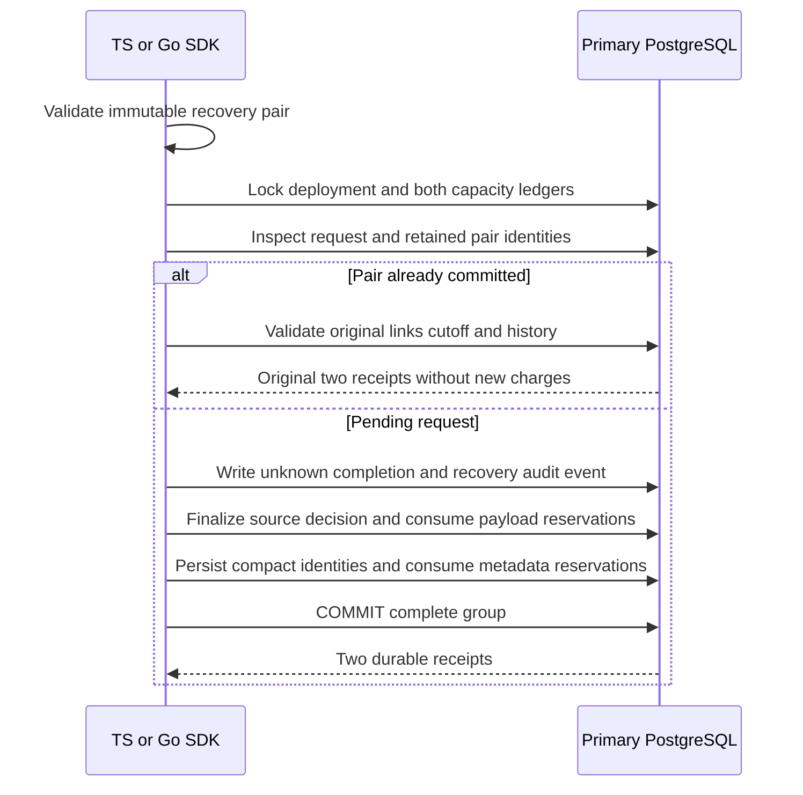

Both SDKs now atomically recover a pending audit decision while preserving its
retained retry identities and accounting. This internal transaction requires a
validated immutable unknown-completion/recovery-administration pair and cutoff.
The caller must authenticate and authorize the initiator. Public v4 activation
and maintenance orchestration remain separate gates.

At full quotas, the pair consumes capacity reserved when the request was admitted.
A late failure in retained resolution rolls back both payloads, deliveries, source
resolution and both accounting ledgers. A late normal completion conflicts. Exact
recovery retries cannot change the initiator or recreate retired payloads.

Live retries validate complete history and source reservation agreement. Retired
retries require intact marker-aware identities for the whole group. Missing or
mixed-state records fail rather than being silently repaired. Cutoff eligibility
also applies to retries.

## Proof

Shared scenarios exercise late injected rollback, too-new requests, full payload
and metadata capacity, exact replay, changed administration, cutoff replay, late
normal completion and missing metadata admission. Both SDKs verify unchanged
storage on failures/retries and cancellation before dispatch. Retired recovered
groups are also retried without recreating payloads.

A separate fault run drops the confirmed COMMIT response from Go, then retries in
TS; the reverse direction repeats independently. The first caller must report
`outcome_unknown`, the peer must resolve the original receipts, and complete
payload/source/identity/accounting snapshots must remain unchanged. This proves
local PostgreSQL retry behavior; it does not authorize remote mutation replay.

Pinned PostgreSQL 17.11 run
`heimdall-capacity-backfill-1af5a34d04994873835481e2cff7914a` passed all 9 shared recovery
scenarios in both SDKs, reciprocal lost-COMMIT retries, retired-pair inspection
and the surrounding migration/capacity/retention regressions. The disposable
container was removed. The full `pnpm run check` gate passed.

Normal retained append COMMIT-loss/handoff qualification, compatible migration and
catalog validation, v4 publication and authorized lifecycle integration remain
required. Phase 3 is still incomplete; see [[phase-3-readiness-audit]].
