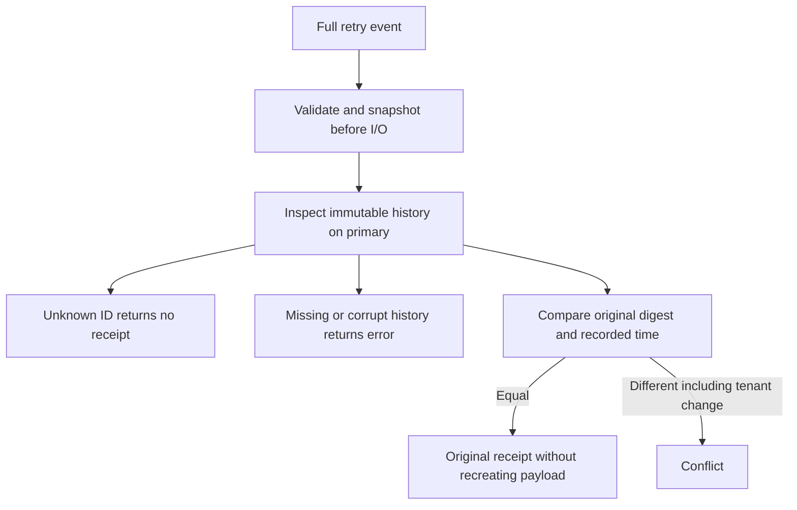

Both SDKs now resolve a complete retry against retained audit history without
recreating the payload. Identical events return their original receipt; changed
events under the same scoped ID conflict.

The shared `retained-retry.json` fixture runs in TS and Go against retired completed
and recovered decisions. Eleven cases cover five retired members, one live retained reference, changed payload,
changed tenant, unknown ID, wrong-product input and invalid event shape. Both
languages compare all receipt fields and verify caller input is unchanged.

The harness snapshots all live event payloads, delivery rows and retained metadata
usage before the two suites and requires an identical snapshot afterwards. This
checks that retirement retries do not create new export work or consume capacity.

Pinned PostgreSQL 17.11 run
`heimdall-capacity-backfill-ca2ed2e5c4584c12b7795fa72f00417f` passed all eleven
shared cases in both SDKs and the unchanged-storage snapshot check. The surrounding
regression harness passed and its disposable container was removed. The full
workspace gate passed.

The resolver is internal and read-only. It does not authorize old business work or
change public append behavior. Public integration still needs compatible atomic
admission to avoid a lookup-then-insert race. This checkpoint does not activate v4
or establish authorized hold/retirement operations. See [[phase-3-retained-inspection]],
[[design/audit-retention]] and [[phase-3-readiness-audit]].
