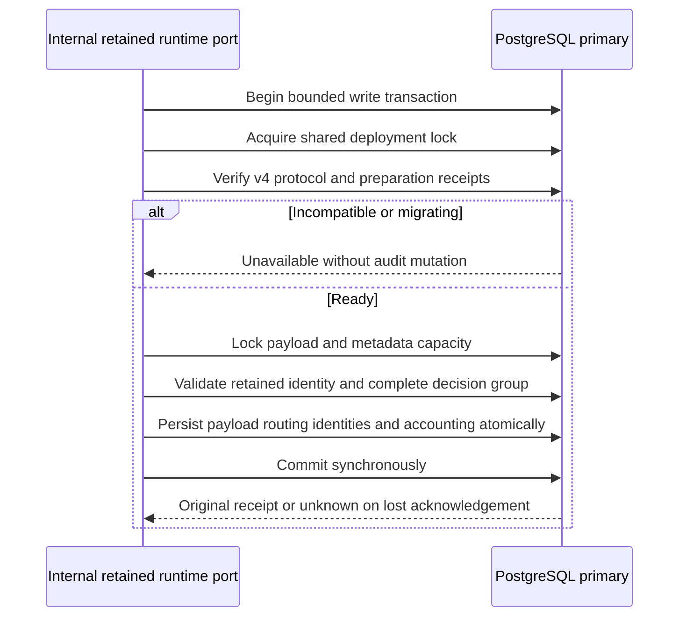

Both SDKs now have an internal retained-audit runtime port requiring the activated
v4 protocol. It exposes append, recovery, inspection, receipt resolution and
eligibility through the existing retained-history implementations. It does not
expose the legacy append paths. Public storage factories still require v3; this
checkpoint is a prerequisite for their coordinated upgrade, not a serving rollout.

## Admission and scope

`NewRetainedRuntimeAudit` in Go and `PostgresAudit.forRetainedRuntime` in TypeScript
construct internal restricted ports without I/O. Every append and recovery takes
the shared deployment lock before checking v4 readiness. The readiness receipt
binds migration checksums, exact reader/writer ranges, completed backfill and quota
limits. Payload capacity is locked before metadata capacity, preserving existing
writer ordering. Even exact retries must pass current admission.

Inspection, receipt resolution and eligibility keep their single-primary-statement
snapshot, replacing the v3 readiness predicate with v4. They retain product,
environment and exact nullable-tenant semantics, full payload/identity validation,
retirement-marker checks and explicit error distinctions. Eligibility remains
advisory and grants no deletion authority.

Go checks primary/read-write connection state before BEGIN because its explicit
read-write transaction option can override the connection default. Both languages
reject read-only connections and migrating or legacy v3 storage. Existing bounded
operations, cancellation and uncertain-COMMIT behavior remain in force.

The restricted runtime role in the integration proof can read protocol receipts,
insert audit payloads/routing/charges and update decision/reservation identities
and used/reserved counters. It cannot delete compact identities, change quota
limits or execute deployment DDL. These grants are test proof, not an automatically
installed production role.

## Verification

The shared `retained-runtime.json` fixture covers ordinary append, decision request
and normal completion, exact completion retry, changed tenant conflict, recovery
and exact recovery retry. Migrating state refuses writes, recovery, inspection and
eligibility without changing storage; restored readiness permits validated reads.
Both SDKs additionally exercise cancellation, restricted privileges, v3 refusal and
read-only append/recovery refusal.

The live harness clones an actually prepared, backfilled and activated database.
After each language writes new history, an activation retry preserves the complete
retention snapshot. Reciprocal confirmed-COMMIT response loss returns unknown in
one SDK; the other SDK resolves the original receipt with unchanged payload,
routing, compact identities and both capacity ledgers.

The complete pinned PostgreSQL 17.11 suite passed in run
`heimdall-capacity-backfill-9a04de0a33b84e90b8bf082ba813e071`, including the new
runtime cases and existing migration, recovery, accounting and retirement-race
regressions. A focused rerun against the same database confirmed exact refusal
error codes and identical returned receipts after tightening those assertions.

The workspace gate passed: 1661 TypeScript tests (120 live-only cases skipped
without their explicit database fixtures), Go race tests, package consumer checks
and Quartz. All 187 Mermaid diagrams passed syntax validation.

## Remaining Phase 3 work

Public factories, identity transaction admission, managed audit composition and
historical recovery resolution must adopt compatible v4 behavior together.
Authorized hold/retry release and retirement must still validate actor, purpose,
policy and full history and commit their audit atomically. Operational and scale
qualification remain required. No purge is enabled and Phase 3 remains incomplete.
