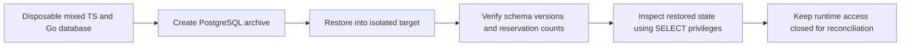

The PostgreSQL drill backs up an activated audit-v5 and managed-v1 database
containing audit events from both SDKs, pending decisions, retired history,
holds, and an uncertain managed operation. It restores into a fresh database
with application connections disabled. The archive excludes ownership and ACLs.
Restore uses one transaction and stops on the first error.

## Restore and reconciliation

1. Create the target with connections disabled and revoke public `CONNECT`.
   Allow connections for the restore administrator and confirm an application
   login is refused. Keep product traffic and maintenance workers on hold.
2. Check `--status managed-v5` with the migration CLI. Compare audit capacity,
   retirement markers and active reservations against the backup inventory. Use
   a dedicated read-only credential to inspect pending decisions, held events and
   unresolved managed operations.
3. Account for changes after the backup, including revocations and operations
   that may have reached OpenFGA. Follow the quiescence procedure in
   [[design/built-in-adapters]] before resolving uncertain operations. Preserve
   workspace gates while the provider state or operation outcome is uncertain.
4. Establish the recovery policy for sessions, outstanding audit deliveries and
   maintenance checkpoints before opening the target to runtime credentials.
   Rebuild runtime grants explicitly. The backup archive does not carry them.

For session invalidation and safe replacement of restored encryption keys, see
[[phase-3-key-rotation-restore]]. A database backup alone cannot account for
provider writes or audit events committed after the backup. This drill covers
local persistence. Coordinated provider recovery and release restore testing
remain open.

## Verified results

Pinned PostgreSQL 17.11 run
`heimdall-capacity-backfill-fab3bd6c6e3f43a6ba6b6ee4dc368fd0` passed the restore
cases in `python3 tests/integration/audit-capacity-backfill.py`. The application
login was refused. The migration CLI accepted `managed-v5` and refused
`managed-v4`. The restored capacity counters and retirement marker count
matched the source, with active hold reservations and pending deliveries.

Under the inspection role, both SDKs read the pending decision without a
terminal result, resolved the retired request's original receipt without
returning its payload, and found the active retry hold. They also read the
uncertain operation and its blocked workspace. The test used a disposable
database and left application access closed throughout the drill.

The Phase 7 repeat `heimdall-capacity-backfill-351dd65705554542b26b5419a168a33b`
passed the isolated restore cases with both SDKs. It used the harness's
`HEIMDALL_TEST_POSTGRES_BIND_ROOT` setting to place the disposable data directory
outside Docker's local volume filesystem. See [[phase-7-coordinated-restore]]
for the separate live-provider drill and the scope of its reconciliation.
