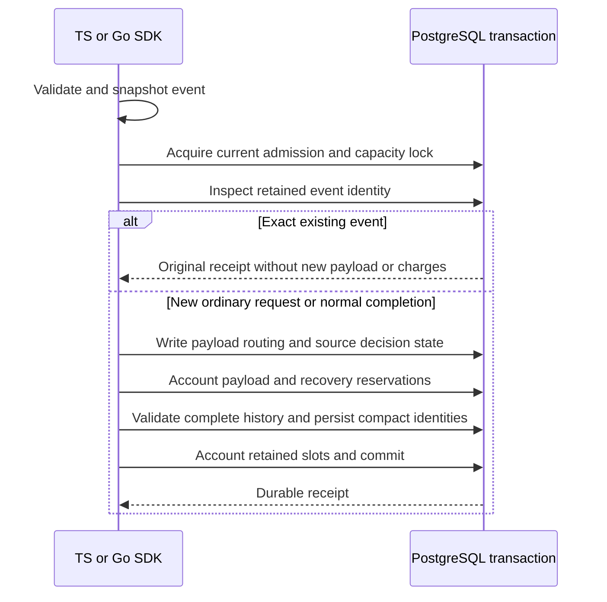
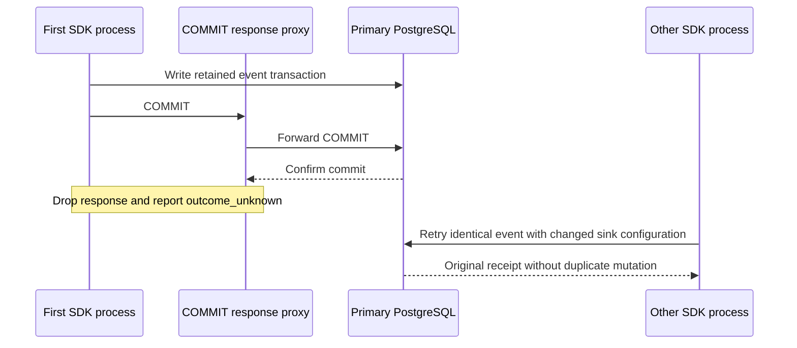

Both SDKs now have an internal append transaction that persists normal audit
history and retained retry identity together. It is not wired into public storage
or activated as v4; compatible migration and recovery integration remain gates.

A request commits both event and decision identities plus reserved terminal/recovery
metadata. A normal completion consumes its reservation and releases the unused
recovery slot, so it can finish at a full metadata quota. A late constraint or quota
failure rolls back payloads, deliveries, source slots, identities and accounting.
Ordinary events cannot slip through when retained metadata capacity is exhausted.

Identical retired retries return their original receipts. Changed payload/tenant
conflicts; a new request cannot reuse an existing retained decision ID. A live event
without expected compact metadata fails rather than being silently repaired.
Receipt resolution grants no permission to repeat business work.

## Verification

Shared retained-write scenarios cover ordinary/request/completion transactions,
late injected failure, insufficient metadata, exact retries, full-capacity normal
completion, changed payload/tenant conflicts, decision-ID reuse and reusable unused
reservations. Missing metadata admission refuses even an exact retry, and
pre-dispatch cancellation remains cancellation. Both suites compare complete payload/source/accounting/identity
snapshots for failures and retries. Existing retained-retry fixtures additionally
exercise the new transactional append against retired completed/recovered events.

Pinned PostgreSQL 17.11 run
`heimdall-capacity-backfill-1788bb2c38e94354a748ea5139fa32d3` passed all 13 shared write
scenarios in each SDK, cancellation checks, transactional retired-receipt retries
and the surrounding migration/recovery/retirement regressions. The disposable
container was removed. The full workspace check passed; the pre-push gate verifies
the final committed tree again.

## Remaining boundary

Prepared schemas and existing v3 admission are prerequisites, not a production
compatibility gate. Catalog validation, backfill/publication, old-writer drain and authorized
maintenance remain required. [[phase-3-retained-recovery]] now provides atomic
retained recovery pairs and their own lost-response proof. Maintenance must share admission and lock ordering.
Public storage continues to use its existing v3 path; no purge is enabled. See
[[phase-3-readiness-audit]].

## Reciprocal normal-write COMMIT loss

The extended harness covers ordinary events, new requests and normal completions.
Each case drops a confirmed COMMIT response from Go and retries in TS, then repeats
from TS to Go in an independent database. The first SDK must return
`outcome_unknown`; a healthy primary read must recover the exact original receipt.
The peer must return that same receipt after process handoff.

Expected counter deltas are checked immediately after the first commit:

| Write | Used payload events | Reserved payload events | Used metadata rows | Reserved metadata rows |
| --- | --- | --- | --- | --- |
| Ordinary | +1 | 0 | +1 | 0 |
| Request | +1 | +2 | +2 | +2 |
| Normal completion | +1 | -2 | +1 | -2 |

The peer retry must leave every payload, delivery, source decision, charge,
reservation, retained identity and capacity row unchanged. The original sink
routing remains intact despite the peer's changed configuration. This is an exact
retry of local audit storage, not a fresh authorization or a business-operation
retry.

Pinned PostgreSQL 17.11 run
`heimdall-capacity-backfill-d921edcd944b42368e320cc8cfd60555` passed all six reciprocal fault
cases and the complete surrounding migration, recovery and retention harness.
The disposable container was removed. The full workspace gate passed.
