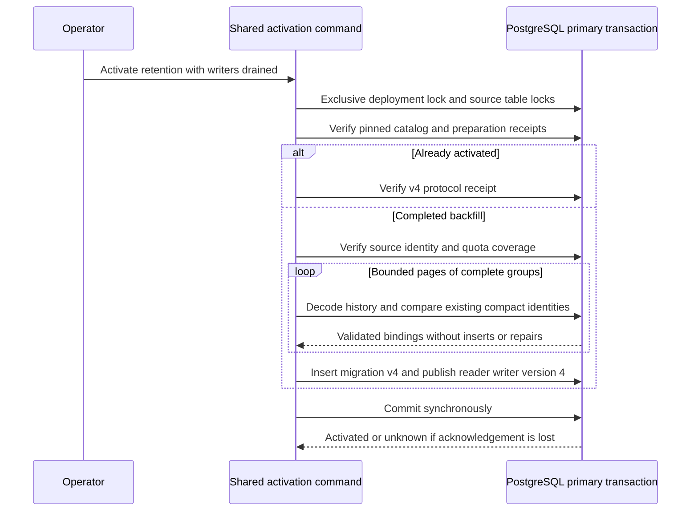

The shared migration command now independently validates completed retention
backfill and publishes schema/protocol v4 atomically. TS and Go have matching
internal standalone and managed readiness checks. Public storage still targets
v3 and correctly refuses v4; do not resume serving until compatible public writer
integration is implemented and qualified. This checkpoint does not enable deletion.



## Commands and compatibility

After [[phase-3-retention-upgrade]] and [[phase-3-retention-backfill]], with all
application writers and maintenance externally drained:

```sh
heimdall-migrate --activate-retention-upgrade --writers-drained
heimdall-migrate --status audit-v4
heimdall-migrate --status managed-v4
```

Use `HEIMDALL_MIGRATION_DATABASE_URL`. Activation checks the connection's primary
and read-write state before beginning its transaction. It has a 30-second context
deadline, five-second lock timeout and 20-second statement timeout. Full-history
validation is page-bounded using the backfill's count/encoded-byte limits, within
one locked activation transaction. Large deployments must qualify that this fits
the deadline; the command fails rather than skipping history or publishing partial
readiness. The drain assertion remains the operator's responsibility.

Migration v4 uses the pinned identity-schema checksum as its catalog entry. The
preparation receipt additionally binds all six SQL files, exact metadata limits
and the completed checkpoint. No historical pinned SQL bytes change. Reader and
writer ranges both become exactly 4 in the same transaction as the ledger entry.
Mixed v3/v4 writers are excluded. Managed storage keeps its separate version 1;
`managed-v4` observes both families in one primary statement snapshot.

## Read-only historical revalidation

Activation first requires completed coverage and agreement between checkpoint,
source payload capacity and retained metadata accounting. It then walks ordinary
history and complete pending/completed/recovered groups from the beginning,
independently of the stored cursor. It decodes every bounded envelope, verifies
portable digests, tenant/context binding, decision and recovery semantics, original
routing and charged bytes, and compares each existing compact identity and decision
binding. Missing identities, changed tenant metadata or corrupt payloads fail.

The group validator is shared with backfill and retained writers, but its activation
mode performs SELECT comparisons only. It cannot UPSERT a missing identity, normalize
a changed one or consume metadata quota. Source and retained tables remain locked
through publication. A failure rolls back the ledger/state transition and leaves
history and its checkpoint unchanged.

If COMMIT acknowledgement is lost, retry checks the activated protocol and its
receipts. It does not rerun migration or use historical scanned counts as if they
still described live history. This is a deployment receipt, not fresh certification
of all subsequent data and not authority to replay application work.

## Shared readiness

Internal `checkRetentionReadiness` / `CheckRetentionReadiness` and their managed
variants bind the four ledger entries, exact v4 reader/writer ranges, capacity
receipts, all six retention checksums, metadata limits and completed preparation.
They are bounded read-only startup checks, not catalog repair or full historical
integrity scans. They preserve cancellation and return `unavailable` for incompatible
or incomplete storage. Runtime transaction admission still needs its compatible
v4 implementation before these checks can be wired into public factories.

Shared `audit-retention-readiness.json` covers ready state, migrating/old-writer
states, wrong migration/preparation checksums, quota receipt mismatch or absence,
incomplete backfill, read-only connections and managed-family failure. Historical
scanned counts are intentionally not live readiness counters. Both SDKs also reject
the activated database through their legacy v3 checks.

## Verification

The pinned PostgreSQL harness activates complete mixed TS/Go history and an empty
database. It checks exact retries, old-writer exclusion, both readiness matrices,
read-only refusal, incomplete backfill, catalog drift, missing identity and compact
tenant corruption. A same-length invalid encoded payload preserves indexed counts,
bytes and digests but must still fail full semantic revalidation.

A restricted test role lacks identity INSERT/UPDATE and quota UPDATE permission;
activation still succeeds, proving validation uses no backfill writes. A second
role cannot publish schema metadata: the attempted migration entry must roll back.
A proxy drops a confirmed activation COMMIT response; retry observes v4 without
changing identities, accounting or checkpoint state. The existing retained writer
and recovery regression suite also exercises the refactored shared validator.

The complete integration suite, including activation and the existing retained
writer/recovery regressions, passed on pinned PostgreSQL 17.11 in run
`heimdall-capacity-backfill-82a92400c4e747119aa52c77b85ba947`. Both SDK readiness
matrices were also rerun against its activated database after adding the explicit
read-only and legacy-v3 checks; Go race tests and both TypeScript cases passed.
The complete workspace gate passed with 1661 TypeScript tests (119 live-only cases
skipped without their explicit fixtures), Go race tests, package checks and Quartz.
All 186 Mermaid diagrams parsed successfully.

## Remaining gate

Public TS/Go storage factories, every retained read/write/recovery admission and
managed audit composition must adopt v4 together with appropriate runtime grants.
Authorized hold/retirement lifecycle composition and operational qualification
remain required. Custom-schema history support remains mandatory before release.
Phase 3 is incomplete, and activating this protocol is not a production rollout.
