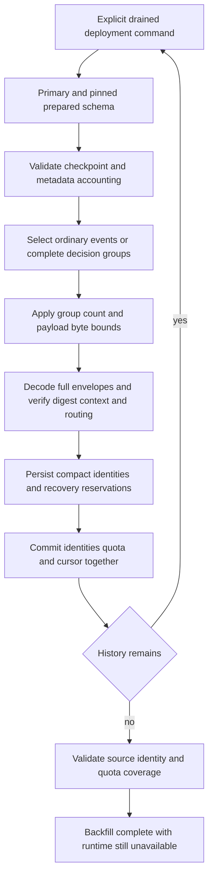

The shared deployment CLI now advances one bounded retention backfill page after
[[phase-3-retention-upgrade]]. It derives tenant scope from validated stored events,
copies complete decision groups and commits metadata accounting with its checkpoint.
Completion does not publish v4 or enable public retention. Writers remain drained.



## Deployment contract

```sh
heimdall-migrate --backfill-retention-upgrade --writers-drained --batch-size 100
```

Use `HEIMDALL_MIGRATION_DATABASE_URL` for the connection. The command returns JSON
with `phase`, scoped `after` cursor, cumulative `scannedEvents` and
`scannedDecisions`, and this page's `processed` group count. Reinvoke until phase
is `complete`. Each invocation resumes persisted progress; callers do not submit
cursors. The same command operates on history produced by either language SDK.

Phases are `ordinary`, `decisions`, then `complete`. Ordinary history excludes all
source decision/reservation members. A decision is copied as one group: one event
while pending, two when normally completed, or three when recovered. A recovery
administration event cannot be independently imported as ordinary history. The
existing full-history builder verifies semantic correlation, portable digests,
tenant binding, charged bytes and original sink routing before compact writes.

One page processes at most 1–100 groups and 8 MiB of encoded payload reads. The
byte budget includes the extra representative read used to derive tenant scope.
A group is never split to fit a page. Individual stored envelopes are capped at
1,500,000 bytes and original delivery lists at 32. The count limit bounds candidate
metadata before payload materialization; the byte limit bounds payload loading,
not PostgreSQL scan cost or total process heap. The operation has a ten-second
context deadline and five-second lock/statement timeouts.

## Progress and failure semantics

An exclusive deployment advisory lock serializes concurrent invocations. Exact
prepared-catalog validation and source-table locks precede copying. Existing
identity counts, decision counts and used/reserved metadata must agree with the
checkpoint before a page resumes and again before committing its advanced cursor. Holds and retirement markers must remain absent
through this offline migration. The quota preflight from preparation is not a
substitute for charging each copied row and reserving future recovery members.

A malformed member, digest/context mismatch, quota failure or cancellation rolls
back the current page, including identities already copied earlier on that page.
Previously committed pages remain durable. Unknown COMMIT means retry the command;
its next invocation loads committed progress and cannot charge the same page twice.
Preparation itself remains safely repeatable after backfill has advanced.

The ordinary phase checks its total coverage before switching to decisions. Final
completion checks all event and decision counts, indexed identity bindings and
original routing, source capacity charges/reservations and retained metadata usage.
A skipped cursor or missing retained identity cannot yield completion. Repeating a
complete backfill checks coverage again without adding identities or reservations.
No history is deleted, no migration version is published, and old runtime admission
continues to refuse the migrating database.

## Verification

The pinned PostgreSQL harness exercises real mixed TS/Go history across Ledger and
Support in production and staging: 15 events, six decisions and four reserved
metadata rows. It tests small pages, concurrent processes, exact completion retries,
preparation retries after progress, independent ordinary/decision COMMIT-response
loss, corrupt second-source page rollback, quota rollback, skipped/rewound cursors and
missing identity refusal. Empty history and exact-fit metadata quotas are also tested. A further 100 large ordinary events prove that the byte
budget stops a page before its group-count limit. Input tests cover invalid limits,
nil dependencies, missing drain assertions and pre-cancellation.

The complete integration suite, including the new backfill cases and existing
retention/recovery regressions, passed in pinned PostgreSQL 17.11 run
`heimdall-capacity-backfill-800ec14c6ef2434ba3187760706f0192`. The workspace gate
passed with 1660 TypeScript tests, Go race tests, package checks and the Quartz
build; all 185 Mermaid diagrams parsed. Live-only cases run separately against
the explicitly provisioned PostgreSQL fixture. Shared
`contracts/fixtures/audit-retention-backfill.json` pins phases, invalid page limits
and the mixed-history counts.

## Remaining activation gate

Backfill completion is coverage evidence, not permission to serve or delete. Atomic
activation must independently revalidate complete current history and compatibility
before publishing v4. Public TS/Go retained writers/readiness and authorized
hold/retirement composition remain outstanding. Built-in event schemas are supported;
custom-history schema registry integration remains a mandatory later release gate.
