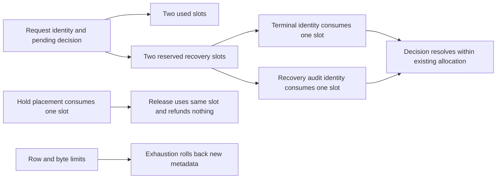

Retained identity and hold history now have a prepared logical row/byte quota.
Every metadata row occupies an 8 KiB allocation, checked against its serialized
size. A pending decision reserves two additional allocations for recovery records.
This is conservative admission accounting, not physical database disk accounting.

The live harness adopts existing TS/Go identity and hold history, verifies the
recount and reservations, and rejects writes without configured capacity. It fills
the quota, rejects another hold, releases an existing hold without additional
space, then races two holds for one available slot. Exactly one may commit. A real
SDK recovery updates the source history; retained terminal/administration identities
then consume reserved slots at the full budget. Repeating the copies must leave
all usage counters unchanged.

Pinned PostgreSQL 17.11 run
`heimdall-capacity-backfill-1d8b2ba604b64c0383fe1f0b9967cd4f` passed the quota
checks and surrounding capacity/recovery harness. Its disposable container was
removed. The full workspace gate passed.

Fixed slots simplify release and resolution growth bounds but intentionally
charge more than many rows use. Metadata history is never silently discarded to
recover quota. The runtime role still has no access to the prepared namespace;
this does not publish v4 or enable deletion. Atomic request admission, authorized
hold operations, migration/activation, physical storage qualification and payload
retirement remain unfinished. See [[design/audit-retention]],
[[phase-3-retention-holds]] and [[phase-3-readiness-audit]].
