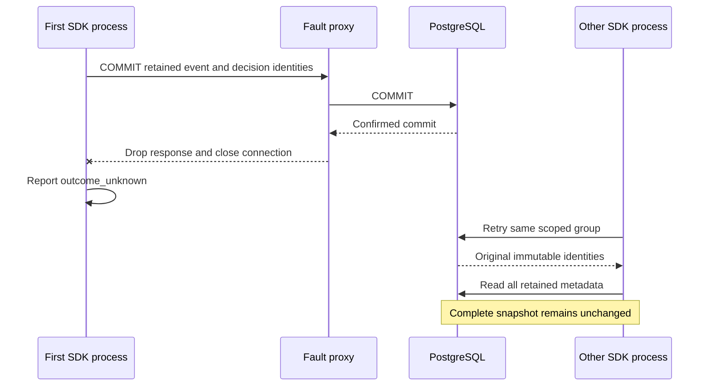

This checkpoint tests the prepared PostgreSQL identity-copy port when the server
commits successfully but the client never receives confirmation. Both SDKs must
report `outcome_unknown`; the other language then retries the same completed group.

The proxy drops a server-confirmed COMMIT response, rather than simulating an
exception before commit. The harness asserts that the drop occurred without a
proxy error. A separate primary connection checks that exactly two event identities
and one completed decision identity committed. The opposite SDK then retries over
a healthy connection. Sorted JSON snapshots of every event and decision identity
must remain equal, including digests, timestamps, tenant, routing and member links.
The test runs Go-to-TS and TS-to-Go in isolated databases with existing mixed-language
history. The one-connection fault proxy is never reused for a follow-up read.

Pinned PostgreSQL 17.11 run
`heimdall-capacity-backfill-e7d317659fe64588838977170bdc8a03` passed both
directions and the surrounding migration/capacity/recovery regressions. The
disposable container was removed. The full workspace gate also passed.

This proves retry behavior for the prepared identity-copy transaction. It does not
prove payload deletion, holds, quota transfer, online concurrency or v4 admission.
Those remain unfinished in [[phase-3-readiness-audit]]. See
[[phase-3-retention-persistence]] for the port's offline boundary.
