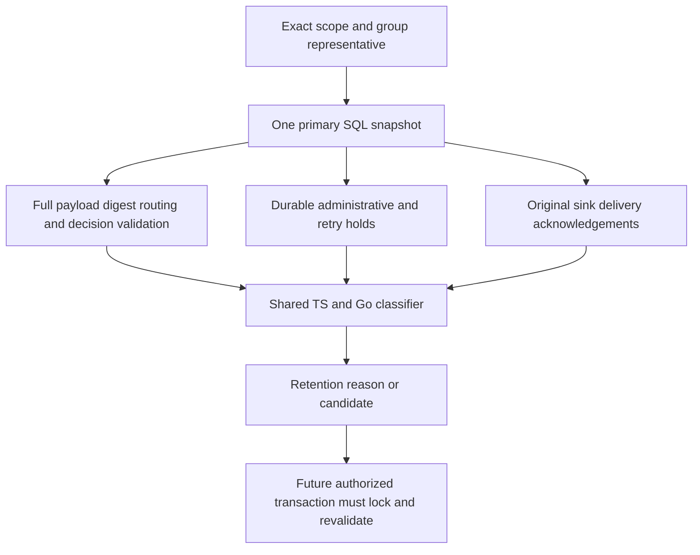

Both SDKs now read retention eligibility from one consistent primary database
snapshot. Callers supply an exact tenant and event, current time, and retention
duration. They cannot assert that deliveries succeeded or holds have cleared.
This internal diagnostic port does not authorize deletion or activate v4.

The representative is an ordinary event or a decision request. Completed and
recovered decisions include every member. The reader verifies compact identity
against full history and source decision/reservation links, then classifies all
members together. Invalid history fails even when a hold would otherwise retain
it. Missing unmarked payload is an integrity error; intentionally retired payload
returns `not_found`. Wrong-tenant and unknown identities return absent.

The snapshot materializes at most three group members plus the representative,
with each stored envelope capped at 1.5 MB. Delivery collections include at most
33 entries so the classifier can reject more than 32. Five-second query bounds
and cancellation remain in force. No payload or mutable storage handle is returned.

## Verification

Shared `retention-eligibility-read.json` scenarios cover both products, pending,
completed and recovered decisions, ordinary events, tenant isolation, invalid
representatives/durations, delivery state, age boundaries, administrative/retry
priority, independent releases, corruption despite a hold, missing source links,
missing payload and readiness refusal. Both suites compare storage snapshots
before and after every inspection. Additional tests cover cancellation and
intentional retirement of complete decisions.

Pinned PostgreSQL 17.11 run
`heimdall-capacity-backfill-db59b27d3a05470e9f3122081b19db29` passed, including all 22
shared eligibility scenarios in each SDK and the surrounding recovery, migration,
retirement and concurrency regressions. The disposable container was removed.
The full `pnpm run check` workspace gate passed.

The first live regression run caught a Go nullable-payload scan regression from
the shared decoder refactor. Direct SQL scans retain byte slices; aggregate JSON
uses raw JSON fields. That failed run is not acceptance evidence.

A candidate is a momentary observation. A later hold or delivery change requires
revalidation inside the eventual authorized retirement transaction. Runtime
identity writes, v4 migration/activation and maintenance orchestration remain
unfinished; see [[phase-3-readiness-audit]].
