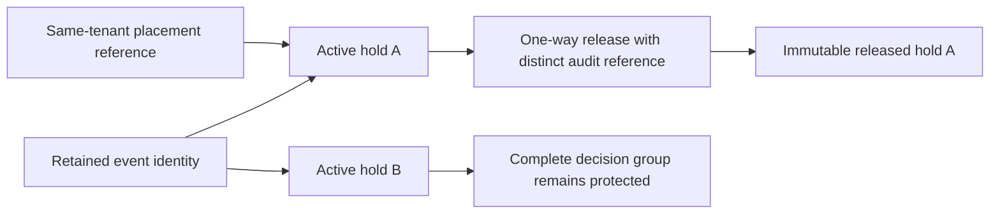

The prepared hold ledger preserves independent hold IDs and their immutable
placement/release history. It is not a public hold API and does not enable retention.

The pinned PostgreSQL harness installs the schema on copied TS/Go history. It
checks DDL rollback, placement rollback, concurrent independent holds, wrong-tenant
and missing-reference rejection, time ordering, source-digest mismatch, immutable
placement, deletion refusal, one-way release, exact release retry and continued
protection when another hold remains active. The runtime role receives no INSERT
privilege on this ledger.

Pinned PostgreSQL 17.11 run
`heimdall-capacity-backfill-4d95e68ee30c4e47b79f9993c0da877c` passed the hold
checks and surrounding migration/capacity/recovery harness. Its disposable container
was removed. The full workspace gate passed. An earlier run rejected an incorrect
test reference to a recovery event in normally completed history; that fixture
reference was corrected before this passing run.

These tests intentionally use existing audit events as reference stand-ins. The
SQL checks indexed identity, scope and time; it does not establish that an event
represents an authorized hold action. Future SDK orchestration must validate the
full administrative event and actor and commit that event, its retained identity
and the hold transition atomically. Hold quotas and compatibility admission remain
unfinished. The target identity lock provides a coordination point for future
retirement, but no deletion workflow yet participates in it. This checkpoint does
not prove a hold-versus-purge race or block privileged direct SQL deletion.

See [[design/audit-retention]], [[phase-3-retention-identities]] and
[[phase-3-readiness-audit]] for remaining release requirements.
