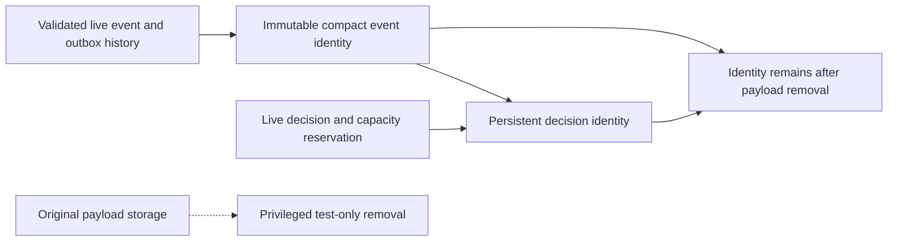

The shared prepared SQL now stores compact event receipts and decision links
independently of the original payload tables. It does **not** enable retention,
register a new runtime version or grant the runtime access to these tables.

Event identity includes scope, tenant, event ID, time, digest, original sorted sink
routing and group membership. The insert guard compares indexed source values,
actual routing, charged delivery count and request/terminal/administration references. It refuses missing
charged history or ambiguous membership. Every stored field is immutable; the
identity cannot be deleted through ordinary DML.

Decision identity references compact event identities. Request binding is
immutable; a pending record can advance to a matching source resolution, and
that terminal state cannot be replaced. Member role, decision, tenant and time
must agree, with foreign keys rejecting missing members. These references survive
payload-table deletion because they point to retained identities.

## Executed evidence

Pinned PostgreSQL 17.11 run
`heimdall-capacity-backfill-3f94ad4db15643e69165fe26e97918f8` passed. Its disposable
container was removed. TS and Go checks pin the same SQL checksum.

The live test rolls back DDL and proves the namespace disappeared, installs it in
an isolated clone, copies existing TS/Go history, and rejects changed digest/time,
omitted routing, wrong tenant grouping, missing terminal identity and wrong role.
It also refuses missing, uncharged or wrong-product sources and a missing sink row
whose original capacity charge still records that delivery.
It then rejects seven mutations/deletions of immutable event and decision fields.
A real SDK recovery supplies the source for a valid pending-to-recovered compact
transition. Finally, a privileged test removes an ordinary payload and a completed
scope's payloads/slots and verifies both compact tables remain byte-for-byte equal
to their prior JSON snapshots. Exact no-op updates still succeed after source
removal. Runtime metadata remains v3, and the runtime role has no access to the
new namespace.

## What this does not prove

The SQL validates indexed structure; full envelope/schema/digest validation and
tenant derivation still belong to the SDK/backfill port. It does not decode ha1
payloads or attest cryptographic correctness itself. The test's privileged removal
is deliberately not an authorized purge workflow and does not check hold/age
policy. No production deletion should use that test sequence.

Durable holds, immutable retirement markers, metadata budgets/reservations, coordinated runtime writes and
receipt reads, migration/backfill/activation, and the authorized retirement
transaction remain required. Existing v3 writers must be drained before compatible
retention is enabled. [[design/audit-retention]] defines the target behavior;
[[phase-3-readiness-audit]] remains incomplete.
