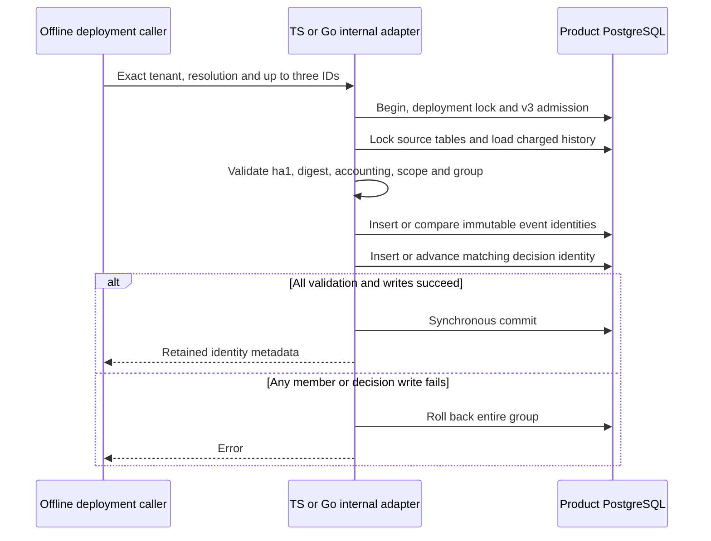

The internal TS and Go PostgreSQL ports now load, validate and persist one complete
retained identity group in a transaction. They require the prepared identity SQL,
drained writers and existing v3 readiness. They do not enable production retention.

The pinned PostgreSQL harness runs each SDK against an isolated clone of real
TS/Go history across two products and two environments. Each test injects a SQL
failure at decision insertion and checks that no event identity survives. It
also checks wrong-tenant refusal, pre-cancellation, corrupt source digest refusal,
exact retry equality and complete event/decision identity coverage.

Pinned PostgreSQL 17.11 run
`heimdall-capacity-backfill-f4b664ff03884a6482cd90700b71d9e5` passed both
prepared-port suites and the surrounding capacity/recovery regression harness.
The disposable container was removed. The full workspace gate also passed.

The ports read original routing rather than current SDK sink configuration. They
check that actual envelope bytes and sink count match existing charges, and
validate full semantics before writing. Source tables are locked for this offline
operation. No payload deletion, runtime grants or compatibility publication occurs.
[[phase-3-retention-commit-loss]] now proves reciprocal lost-COMMIT response
and retry behavior through a network fault proxy. Metadata budgets, holds,
retirement markers, checkpointed migration and runtime integration remain required.
See [[phase-3-retention-validation]], [[phase-3-retention-identities]],
[[design/audit-retention]] and [[phase-3-readiness-audit]].
