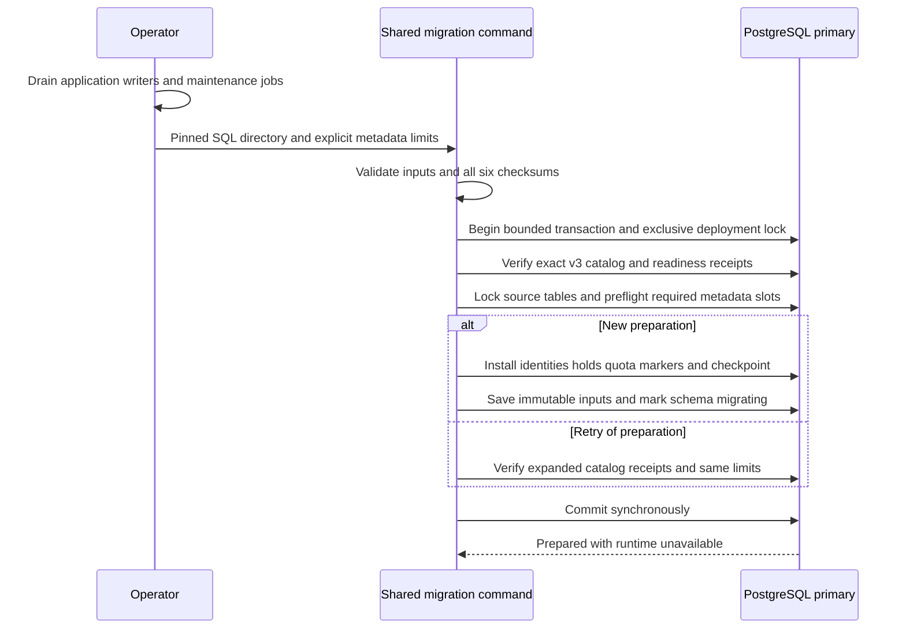

The shared deployment command can now prepare retention storage from an activated
v3 database. It installs the five previously pinned retention files and a new
receipt/checkpoint schema atomically. It does not backfill identities, publish v4,
activate retained writers or enable payload retirement. Phase 3 remains incomplete.



## Operator invocation

Stop all application writers and maintenance jobs and prevent automatic restart
before running this command. The assertion is an operator responsibility; a
PostgreSQL advisory lock cannot prove external quiescence. The same deployment
binary serves TypeScript and Go applications, without a companion service.

```sh
heimdall-migrate --prepare-retention-upgrade --writers-drained \
  --sql-directory contracts/persistence/session \
  --retention-rows 1000 --retention-bytes 8192000
```

The connection comes from `HEIMDALL_MIGRATION_DATABASE_URL`. Limits are explicit
operator choices, not production sizing recommendations. Each retained event,
decision, hold or retirement marker consumes a conservative 8192-byte logical slot.
Before any DDL or serving outage, the transaction requires room for all existing
events plus decisions plus two future member slots for every pending decision.
It uses numeric arithmetic and locked source tables; either row or byte shortage
refuses preparation and preserves v3 readiness. This is a logical metadata budget,
not a measurement of PostgreSQL pages, indexes, WAL or backups.

The new tables initially contain no copied identities and no used/reserved metadata
slots. Subsequent bounded backfill must validate full history and charge each
identity/reservation before activation. Preparation does not certify that all
historical envelopes are semantically valid. Runtime metadata stays at version 3
with state `migrating`, making old TS/Go admission unavailable. No runtime role
receives retention namespace access and no version 4 migration is published.

## Retry and failure behavior

Preparation checks the exact PostgreSQL 17 structural profile, including existing
v3 objects and all retention columns, constraints, indexes, triggers and functions.
A partially installed or manually altered namespace is refused, not adopted or
repaired. Repeat preparation verifies the recorded six checksums and both limits.
Different limits conflict; exact repeats preserve receipt timestamps, progress and
accounting. Future backfill will use the private durable checkpoint rather than
public v3 identity-copy admission, which now correctly refuses the migrating state.

Operations have a 30-second context deadline, five-second lock timeout and
20-second statement timeout. Cancellation remains distinct. DDL, receipts, quota
initialization and state transition share one synchronous transaction. A lost
COMMIT response returns `outcome_unknown`; retry verifies committed state rather
than reinstalling tables or resetting progress.

## Verification

The pinned PostgreSQL integration harness tests preparation over mixed TS/Go
ordinary, pending, completed and recovered history in two products and environments.
It checks exact-fit quotas, independently insufficient row/byte limits, invalid CLI
combinations, read-only refusal, old catalog drift, partial namespaces, concurrent
preparation, changed-limit conflict and post-preparation catalog drift. An injected
late DDL failure must roll back every retention object and preserve v3 readiness.
Both SDK readiness checks reject the prepared database. A proxy drops a confirmed
COMMIT response; retry must preserve the preparation snapshot without duplicate
DDL, quota initialization or receipt changes. Runtime grants remain absent.

Shared `audit-retention-upgrade.json` pins all six SQL files and the expanded
catalog signature in both SDK test suites. Go input tests cover missing drain
assertions, invalid bounds, altered SQL, nil inputs and cancellation before I/O.
The live command is `python3 tests/integration/audit-capacity-backfill.py`.

The complete integration harness, including the preparation cases and existing
retention/recovery regressions, passed on pinned PostgreSQL 17.11 in run
`heimdall-capacity-backfill-d6e89286b95d478da1cd123bf5751bc6`. The complete workspace
gate also passed: 1660 TypeScript tests (118 live-only cases skipped without their
explicit database fixtures), Go race tests, package checks and Quartz build, with
184 Mermaid diagrams parsed successfully. Live-only preparation/readiness cases
were separately executed by the PostgreSQL harness above.

The first live run exposed a read-only admission bug: Go transaction creation
cleared the connection default before inspection. Preparation now checks the
primary/read-write connection before beginning the transaction. A later test-only
correction uses readiness's `unavailable` error, distinct from audit-write errors.

## Remaining gate

Bounded full-history backfill, coverage validation, atomic v4 activation, compatible
public writer/readiness wiring, authorized administrative hold/retirement
composition and operational qualification remain required. Keep applications
stopped after preparation: this checkpoint deliberately has no activation command.
The deployment outage is not complete merely because preparation succeeded.
