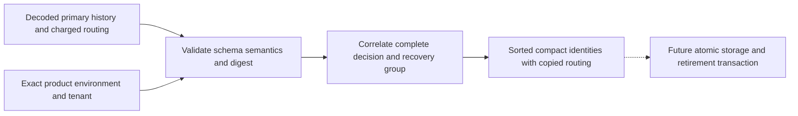

Both SDKs now construct compact identities from a complete, validated built-in
audit group. This closes the payload-semantic gap left by the prepared SQL's
indexed-value checks. It does not activate retention or write to storage.

The shared `retention-identity-validation.json` fixture exercises ordinary,
pending, completed and recovered groups, including unordered inputs. Sixteen
rejection cases cover wrong product/tenant, corrupted digest, missing or duplicate
routing, missing charged sink, orphaned/missing group members, wrong resolution,
changed decision context, invalid recovery actor/target/time and unknown fields.
Both language suites check sorted identifiers/routing and output metadata; mutation
checks prove returned routing does not change the source. Go also verifies tenant
pointer independence. The focused TS suite passed all 20 cases, and the Go suite
passed with the race detector.

Storage must still decode and validate the ha1 envelope and read routing/charges
from a consistent primary snapshot. The builders validate supplied decoded facts;
they cannot establish that a caller loaded every database row. SQL insertion guards
provide a separate source comparison. This is a built-in-event implementation;
custom registry composition, runtime persistence, holds, accounting, retirement
markers and authorized deletion remain required. See [[phase-3-retention-identities]],
[[design/audit-retention]] and [[phase-3-readiness-audit]].
