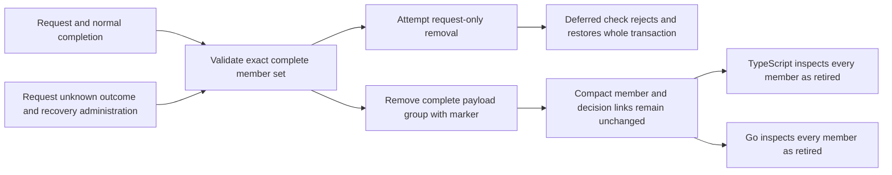

Retirement qualification now includes both a completed decision's two records and
a recovered decision's request, unknown outcome and recovery administration record.
The immutable compact decision and all member identities must survive together.

The shared `retired-decision-inspection.json` fixture selects Ledger staging's
completed history and Support production's recovered history. Go appends fresh,
valid audit events as structural retirement-reference stand-ins and retains their
identities through the internal port. These are not authorized retirement events.

For each group the harness first removes only the request after detaching its
source slot/reservation. The deferred marker check must reject commit; every member
payload must remain. Complete removal then commits with one marker. A snapshot of
all compact event and decision identities must remain byte-for-byte equal, while
metadata usage increases by exactly two marker slots across the two groups.

Both SDKs inspect all five retired members from the same database. Each result
must retain its event/decision identity and contain no payload. Each separate
retirement reference remains live and readable. This extends the ordinary-event
inspection proof without changing public API behavior.

Pinned PostgreSQL 17.11 run
`heimdall-capacity-backfill-456f4e886de9437eb6df2d39bd04d8c2` passed both
group-retirement cases, TS/Go inspection and the surrounding regression harness.
Its disposable container was removed. The full workspace gate passed.

The tests use privileged disposable-database transactions. They do not establish
administrative authorization, explicit retry-obligation enforcement, whole-group
hold races or v4 activation. Those remain required alongside public SDK integration.
See [[phase-3-retirement-markers]], [[phase-3-retained-inspection]] and
[[phase-3-readiness-audit]].
