Both SDKs scan the primary in pages of up to eight live audit keys. Each page
uses one snapshot. It applies the exact tenant filter after selecting the
bounded keys for the product and environment, then checks age, routing and
protections across each matching group. It returns eligible root IDs. The
internal cursor advances over examined keys even when none are eligible.

```mermaid
flowchart LR
  Schedule[Product schedules one scoped sweep] --> Page[Read a bounded page on the primary]
  Page --> Filter[Filter tenant root kind and age]
  Filter --> Verify[Check full group routing and protections]
  Verify --> Proposal[Save proposals and advance cursor together]
  Proposal --> Command[Run authorized retirement command]
  Command --> Recheck[Recheck group under write locks]
  Recheck --> Receipt[Commit administrative audit and retirement receipt]
```

A fresh sweep starts from the beginning to find newly inserted keys and groups
that became eligible after an earlier page. The product keeps cursors private
to its maintenance job and uses the same proposal ID and timestamp when
retrying an unknown outcome. A candidate can become protected before dispatch.
The retirement transaction checks the current group under lock. The page caps
source keys and sequential group reads. Physical cost of checking marker history
at production volumes still needs qualification.

Pinned PostgreSQL run `heimdall-capacity-backfill-755389ad280f489e9fc27043bc62deef`
verified both SDKs under a SELECT-only role before and after retirement.
The shared cases cover sparse pages, exact null and named tenant selection,
pending and held history, late delivery, completed and recovered groups,
retired roots, cursor scope and time checks, and cancellation. PostgreSQL
used an index-only scan on the existing audit primary key for the bounded
source query. Both SDKs also found a product-level target by following the
cursor, then retired it through the authenticated command and verified the
original receipt on retry.
