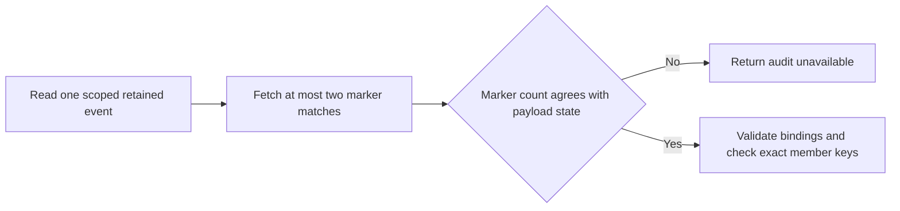
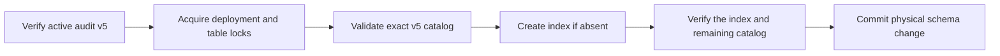

TypeScript and Go now fetch up to two marker matches once per retained event
lookup. A second match still fails inspection. The check for surviving payloads
uses the event and decision member keys against the audit event primary key.

Run `heimdall-marker-scale-7a6424aed58843f18489d382199f1157` used pinned
PostgreSQL 17.11 and synthetic retirement markers for two products in the same
environment. The probe uses the existing retirement table definition with
fixture identity keys and measures the scoped marker predicate in isolation.

| Lookup | Markers per product | Rows filtered | Shared blocks | Execution time |
| --- | ---: | ---: | ---: | ---: |
| Miss with existing schema | 1,000 | 2,000 | 35 | 0.555 ms |
| Miss with existing schema | 100,000 | 200,000 | 3,818 | 58.705 ms |
| Miss with candidate GIN index | 100,000 | 0 | 4 | 0.242 ms |
| Hit with candidate GIN index | 100,000 | 1 | 5 | 0.397 ms |

The candidate uses `gin(member_event_ids)` with the default JSONB operator
class, which supports the existing membership predicate. Identical member IDs
in different products still yielded one scoped match. A second match inside
the same product yielded two. These are single-query measurements on a local
fixture. They establish the scan cost and index access path. Application
latency and behavior under concurrent write load need separate measurements.

## Deployment

After audit v5 activation, run the deployment CLI with
`--install-retirement-index --writers-drained --sql-directory` and the shared
session SQL directory. Drain application writers and maintenance jobs before
running the command. Index creation takes a table lock that blocks writes and
is limited to 20 seconds per statement. Budget disk space for index creation.
If the build exceeds the deadline, PostgreSQL rolls back the transaction.
After a lost commit response, rerun the exact command to validate the catalog.

The maintenance command accepts the original catalog and the catalog with the
exact GIN index. A same-name index on another column or unrelated catalog drift
causes refusal. Both forms use the same v5 runtime protocol and migration
receipts, so the index requires no SDK upgrade. The updated migration command
recognizes both forms when retrying v5 activation. Use the updated command for
deployment operations once the index is installed.

Railway PostgreSQL 17.11 run `c47c982752234b5db499af8bf62f3d96` installed
the index in a disposable application database, verified a repeat invocation,
and repeated v5 activation and restricted readiness. The SELECT-only role
could not install the index. The probe removed the database, role and upload
directory. Its JSON record is
`tests/integration/evidence/retirement-index-railway-2026-11-13.json`.

The populated local run `heimdall-capacity-backfill-247070192f2946fdb7eb019d03b682be`
refused a v4 database and an index with the expected name on the wrong column.
A proxy discarded the successful index commit response. The next invocation
verified the committed index. Backup and restore preserved the index, and both
SDKs passed their restored-state checks.

## Index build and writes at one million markers

Local pinned PostgreSQL 17.11 run
`heimdall-marker-scale-9351765ec5894e288032d5f975273bc7` applied the exact
deployment SQL to one million synthetic markers. The build completed in
16.605 seconds of elapsed time with the same 20-second SQL statement deadline
as the CLI. On this dataset, an indexed miss used four shared blocks and a
scoped hit used five.

A writer then committed 20,000 markers across Ledger and Support in batches
of 1,000. Thirty reads ran while the writer was active. All returned the
expected scoped match despite the same member ID appearing in 128 additional
products. The largest concurrent lookup touched 167 shared blocks. The newest
committed marker was visible before and after flushing 159 GIN pending pages.
That lookup touched 164 shared blocks before cleanup and five afterward.

The probe uses the deployed marker table definition and synthetic identity
keys. It disables autovacuum on the marker table during the write test to
observe pending-list behavior. It measures the SQL build and lookup, so the
16.605-second result applies to this machine and fixture. End-to-end audit
throughput and build time on a target deployment still require qualification.

Reproduce with `python3 tests/integration/retirement-marker-scale.py` on a
Docker host with space for roughly 1.02 million markers and 2.04 million
identity keys. Set `HEIMDALL_TEST_POSTGRES_BIND_ROOT` to an existing disk-backed
directory if the Docker data volume is constrained. The probe removes its
database container. The recorded plans and counts are in
`tests/integration/evidence/retirement-marker-load-2026-11-13.json`.
