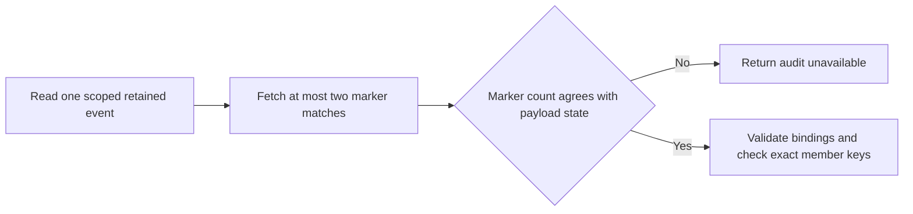

TypeScript and Go now fetch up to two marker matches once per retained event
lookup. A second match still fails inspection. The check for surviving payloads
uses the event and decision member keys against the audit event primary key.

Run `heimdall-marker-scale-7a6424aed58843f18489d382199f1157` used pinned
PostgreSQL 17.11 and synthetic retirement markers for two products in the same
environment. The probe uses the existing retirement table definition with
fixture identity keys and measures the scoped marker predicate in isolation.

| Lookup | Markers per product | Rows filtered | Shared blocks | Execution time |
| --- | ---: | ---: | ---: | ---: |
| Miss with existing schema | 1,000 | 2,000 | 35 | 0.555 ms |
| Miss with existing schema | 100,000 | 200,000 | 3,818 | 58.705 ms |
| Miss with candidate GIN index | 100,000 | 0 | 4 | 0.242 ms |
| Hit with candidate GIN index | 100,000 | 1 | 5 | 0.397 ms |

The candidate uses `gin(member_event_ids)` with the default JSONB operator
class, which supports the existing membership predicate. Identical member IDs
in different products still yielded one scoped match. A second match inside
the same product yielded two. These are single-query measurements on a local
fixture. They establish the scan cost and index access path. Application
latency and behavior under concurrent write load need separate measurements.

Reproduce with `python3 tests/integration/retirement-marker-scale.py` on a
Docker host with space for 200,000 markers and 400,000 identity keys. Set
`HEIMDALL_TEST_POSTGRES_BIND_ROOT` to an existing disk-backed directory if the
Docker data volume is constrained. The probe removes its database container.

The candidate index needs a versioned migration and a compatible catalog
signature. Existing v4 and v5 migration checksums remain immutable. Scope-heavy
member ID collisions and index maintenance under write load also need testing.
