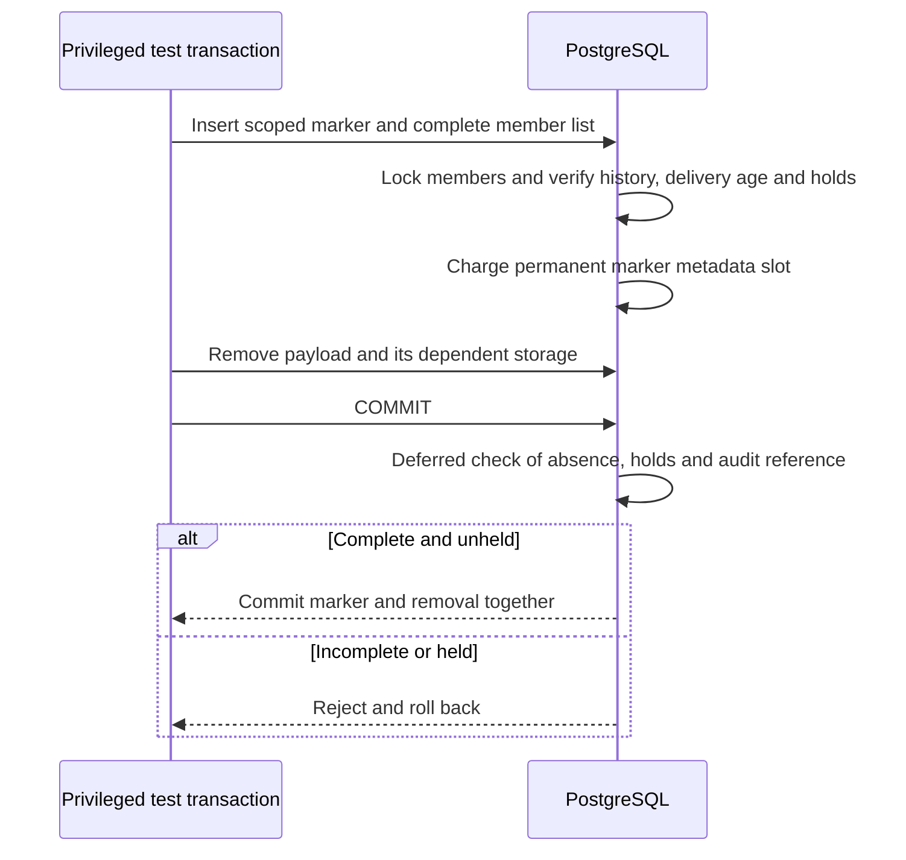

The prepared marker ledger records exactly which payloads a retirement transaction
removed. A deferred constraint prevents the marker from committing while any
listed payload remains. It also rejects active member holds at commit.

The pinned PostgreSQL harness checks DDL rollback, undelivered and too-young history,
wrong tenant/reference/member list, missing original routing, active hold refusal,
marker-without-removal rollback, and a hold added after marker insertion in the
same transaction. A privileged positive case retires one ordinary event. Its
compact identity remains; the marker and metadata charge persist. Changed or
deleted markers refuse, exact no-op updates preserve accounting, and quota
re-adoption includes the marker.

Pinned PostgreSQL 17.11 run
`heimdall-capacity-backfill-70d7ec962dbf4d9db5f486ee31a875c4` passed these
marker checks and the surrounding migration, capacity and recovery regressions.
Its disposable container was removed. The full workspace gate passed.

The administrative reference in this structural test is an existing event used
as a stand-in. This does not prove authorized administrative event semantics or
provide a production purge procedure. The marker's duration is a trusted input;
policy authorization and explicit retry obligations belong to the future SDK
transaction. [[phase-3-retirement-races]] adds separate-connection hold/retirement races for
ordinary events. Whole-decision retirement, marker-aware reads, migration and v4
activation remain unfinished. Runtime grants are unchanged.
See [[design/audit-retention]], [[phase-3-retention-capacity]] and
[[phase-3-readiness-audit]].
