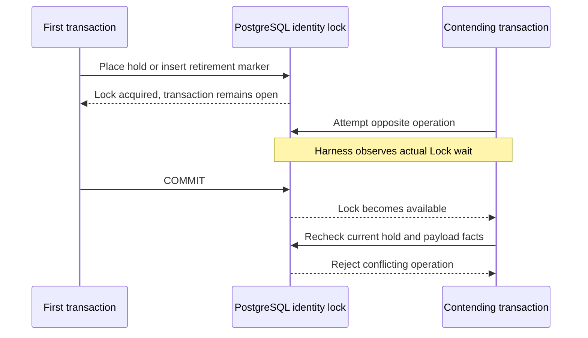
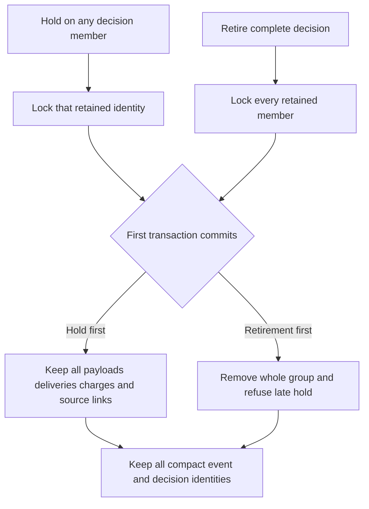

This checkpoint exercises hold placement against ordinary-event and complete-decision retirement on
separate PostgreSQL connections in both commit orders. It tests the prepared SQL
locking protocol; it does not expose a production hold or purge API.

For hold-first, the hold commits, the contending retirement refuses, and the
payload survives. For retirement-first, removal and marker commit together, and
the late hold refuses because its target payload is gone. Each case must leave
exactly one new metadata allocation, with no marker/hold left by the loser.

The owner transaction signals only after acquiring its locks. The harness then
observes the contender's `pg_stat_activity.wait_event_type = Lock` before committing
the owner. Bounded statement/process deadlines prevent a deadlock from being
mistaken for successful exclusion. Existing audit events remain structural
reference stand-ins; this test does not attest administrative event authorization.

Pinned PostgreSQL 17.11 run
`heimdall-capacity-backfill-6c2aacb632c34cdab0e557f0a0696a2f` passed both
observed-lock races and the surrounding migration, capacity and recovery harness.
Its disposable container was removed. The full workspace gate passed.

## Complete-decision member races

The extended proof covers Ledger's completed decision (request and completion)
and Support's recovered decision (request, unknown completion and recovery
administration). Each of the five members is independently held against whole-group
retirement in both commit orders: ten additional observed-lock races.

Each race checks the complete payload and charge counts, delivery count, source
decision and reservation, marker/hold winner, immutable compact event and decision
snapshots, and exactly one new metadata slot. The contender must actually wait on
a PostgreSQL lock before the first transaction commits; a timeout or deadlock is
not a passing result. Independent database clones keep every race isolated.

Extended pinned PostgreSQL 17.11 run
`heimdall-capacity-backfill-8b9ae8bcf3804b45b316b8176bb502d8` passed all ten member races and the
surrounding TS/Go recovery, capacity, migration and retention harness. Its disposable
container was removed. `pnpm run check` passed; the final pre-push gate checks the
committed tree again.

The result is limited to PostgreSQL's tested READ COMMITTED behavior and privileged
test transactions with administrative reference stand-ins. Explicit retry
obligations, authorized SDK orchestration and v4 activation remain required. See
[[phase-3-retirement-markers]], [[phase-3-retention-holds]] and
[[phase-3-readiness-audit]].
