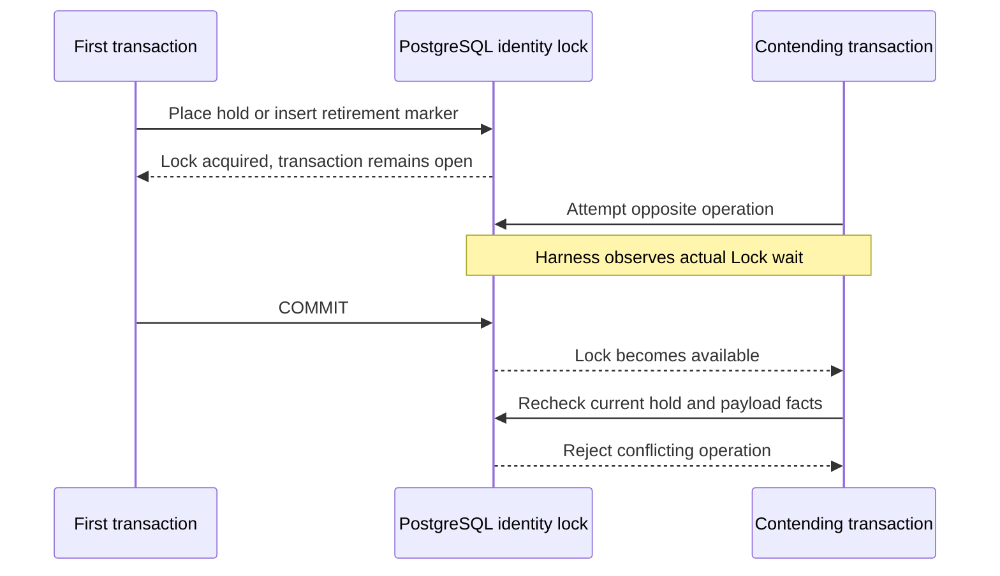

This checkpoint exercises hold placement against ordinary-event retirement on
separate PostgreSQL connections in both commit orders. It tests the prepared SQL
locking protocol; it does not expose a production hold or purge API.

For hold-first, the hold commits, the contending retirement refuses, and the
payload survives. For retirement-first, removal and marker commit together, and
the late hold refuses because its target payload is gone. Each case must leave
exactly one new metadata allocation, with no marker/hold left by the loser.

The owner transaction signals only after acquiring its locks. The harness then
observes the contender's `pg_stat_activity.wait_event_type = Lock` before committing
the owner. Bounded statement/process deadlines prevent a deadlock from being
mistaken for successful exclusion. Existing audit events remain structural
reference stand-ins; this test does not attest administrative event authorization.

Pinned PostgreSQL 17.11 run
`heimdall-capacity-backfill-6c2aacb632c34cdab0e557f0a0696a2f` passed both
observed-lock races and the surrounding migration, capacity and recovery harness.
Its disposable container was removed. The full workspace gate passed.

The result is limited to ordinary events and PostgreSQL's tested READ COMMITTED
behavior. Complete-decision retirement, explicit retry obligations, authorized SDK
orchestration, marker-aware readers and v4 activation remain required. See
[[phase-3-retirement-markers]], [[phase-3-retention-holds]] and
[[phase-3-readiness-audit]].
