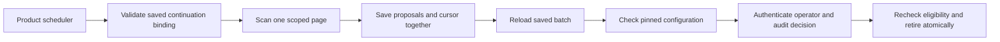

The product schedules one page at a time. Each SDK builds stable operation
IDs and passes the proposals and cursor to the product's persistence callback.
The callback saves the batch and advances the cursor in one transaction.
Empty pages can still advance. A lost commit response requires reading the
durable queue before dispatch.

The saved batch binds the policy, model, manifest and duration. The saved
continuation also binds those fields and the sweep ID, so changed configuration
cannot advance the saved sweep. The product owns
the queue, scheduling and credential supply. It keeps the original proposal
for a retry after an unknown outcome.

The shared fixture verifies identical proposal IDs, cursor advancement on
an empty page, conflict after a simulated lost save response and rejection
after a policy version change. Pinned PostgreSQL run
`heimdall-capacity-backfill-dfb40dbaeaa74833bf9da89eeb1e7990` saved batches
and cursor updates in the same SQL statement. The queue test tables were
added to the disposable template during the run. Go reloaded one saved page
and TypeScript reloaded three. Each SDK dispatched its saved target, received
the original receipt on retry, and left one matching retirement marker.

Both SDKs use the same fixture to verify the continuation digest, resume at the
saved position and reject a changed model or sweep ID before calling the reader.
Previously saved continuations without a binding ID need a fresh sweep.
