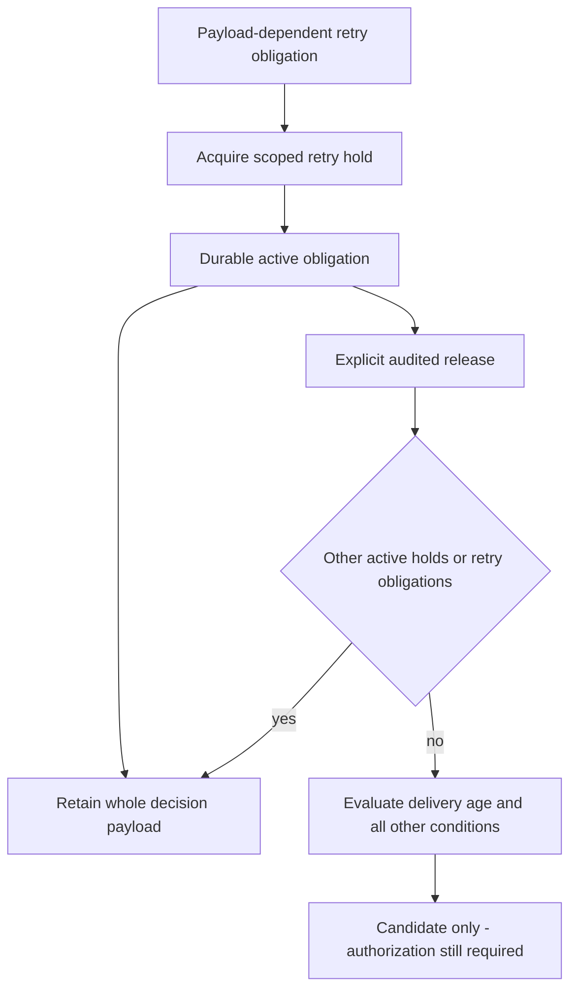

Prepared retention storage now distinguishes administrative holds and retry
obligations through an immutable purpose on the existing hold ledger. Existing
rows adopt administrative purpose. Both purposes share scope, audit references,
whole-decision locking and metadata accounting. This does not publish a public
retention API or activate v4.

There is no timeout or lease expiry. A stopped worker cannot silently clear its
obligation. One release never clears another hold, and released history cannot be
reopened, deleted or relabeled. Keeping obligations in the hold ledger avoids a
second protection/locking mechanism and uses the existing fixed metadata slot.
The tradeoff is conservative retention: abandoned obligations require explicit
reconciliation and authorized release.

## Proof

The shared SQL checksum is checked by TS and Go. The pinned PostgreSQL harness
checks transactional DDL rollback, default adoption, invalid and changed purpose
refusal, independent obligations, immutable/no-op release, quota exhaustion and
release at full capacity without refunds. Retry protection participates in both
immediate retirement validation and deferred commit validation.

It also tests both commit orders for each member of a completed decision and a
recovered decision, for both administrative and retry holds: twenty observed-lock
races. A winning hold preserves the whole group; a winning retirement refuses the
late hold. The loser leaves no charge, hold or marker. Compact identities and
links remain unchanged. Tests use the mixed TS/Go history and existing structural
audit-reference stand-ins.

Pinned PostgreSQL 17.11 run
`heimdall-capacity-backfill-0ed7c99c79864d41b7f65ca136fe5833` passed the complete harness,
including all twenty races. The disposable container was removed.
`pnpm run check` passed, including 1,659 TS tests, Go race tests, package checks,
and Quartz validation of all 179 Mermaid diagrams. Database-dependent tests
skipped by the ordinary workspace run are exercised by the explicit live harness.

## Remaining boundaries

The SQL validates indexed references, not administrative authority or full event
purpose. SDK acquisition/release orchestration, automatic obligation registration,
classifier storage reads, compatible runtime writes, v4 migration/activation and
public authorized maintenance remain incomplete. This ledger cannot establish
that an application has finished retrying; the trusted workflow must supply that
evidence before release. See [[phase-3-readiness-audit]].
