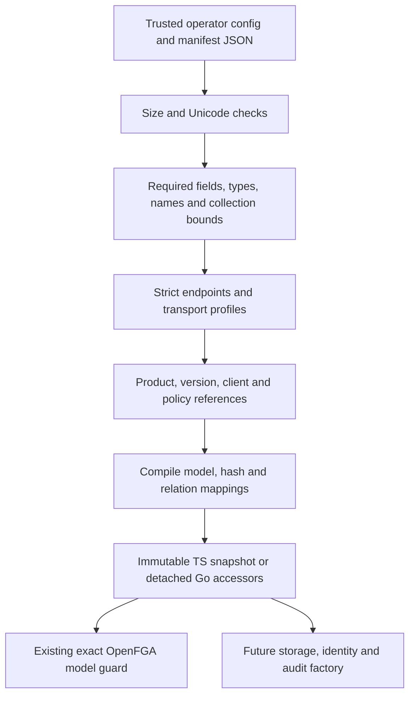

Both internal SDKs can now load a deployment configuration and product manifest without relying on external schema files or caller-supplied structural validators. The loader validates the full local structure and policy binding before compiling the model and capturing a detached deployment snapshot.

Each input is bounded to one MiB. Unknown fields, malformed endpoints, duplicate array entries, invalid sizes and dangling policy references fail with invalid_argument without exposing the rejected input. Credentials remain separate explicit loaders. Production HTTPS and explicit loopback profiles retain their existing endpoint restrictions.

TypeScript recursively freezes the validated result. Go stores the deployment privately and returns copies, including detached maps/slices for manifests and compiled artifacts. Go JSON tags preserve contract field names on serialization, and integer JSON spellings such as 1e0 are normalized before typed decoding. Both runtimes reject malformed Unicode rather than repairing identifiers. The loader makes no network calls and performs no provisioning or storage writes.

## Evidence

The existing config/manifest schema vectors and `contracts/fixtures/configuration-v1.json` run in both SDKs. New cases cover scope/version/client/profile mismatches, unknown fields, permission/delegation references, forbidden owner delegation, role/client/permission count boundaries, supplementary Unicode string lengths, snapshot mutation and malformed/oversized input. Go config and manifest accessors also round-trip through the same loader.

Railway OpenFGA run `221fee6e-a989-4319-9b97-c8850926e389` passed after both live SDK tests were changed to load configuration/manifest through this boundary before verifying the remote model. Ledger, Support and custom-owner policy snapshots verified successfully. The existing role, membership, delegation, cross-tenant and cross-product model regression checks also passed, and all owned stores were deleted.

Machine-readable evidence is in `tests/integration/evidence/runtime-configuration-2026-11-11.json`. The full workspace gate passed 1,074 TypeScript tests, Go race tests, formatting/lint/types/Knip and SDK/Quartz builds. The 24 optional live tests are skipped in the default environment; the Railway probe supplies credentials separately for its SDK checks.

## Remaining work

Local validity does not establish remote readiness or ownership of an external project/store. The operator-supplied binding remains trusted, and factories must still require exact model verification, storage readiness, credential loaders, identity gates and durable audit. Public factory/session/authorization composition is not provided by this loader. Phase 3 remains active.
