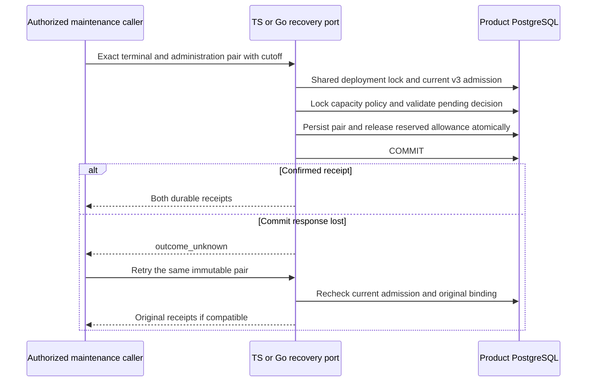

TS and Go now provide internal maintenance recovery ports that enforce current
capacity-v3 compatibility inside the recovery transaction. This closes the
prepared-port admission gap before scheduling is composed. It does not expose
an unauthenticated public maintenance API or certify Phase 3 complete.

The runtime port reuses full shape/semantic validation, original request binding,
cutoff eligibility, deterministic administration binding and atomic capacity
accounting. It holds shared deployment admission through COMMIT. Incompatible
storage blocks exact retries as well as new recovery attempts. The older prepared
ports remain internal migration/test primitives and do not publish readiness.

## Live proof

The extended capacity integration runs four isolated activated databases: Go and
TS recovery, each with and without confirmed COMMIT-response loss. Restricted
roles recover the other language's pending history. The test fills the event
budget to used plus reserved capacity, then verifies:

- Pending scan returns the historical request before recovery and none afterward.
- Old and migrating compatibility refuse recovery without admitting it.
- The terminal/administration pair fits the existing reservation at full capacity.
- Exact retries preserve both receipts and charge only two new events while
  releasing exactly two reserved events.
- A late normal completion conflicts and cannot replace the recovered result.
- Changing metadata to migrating after success refuses an exact recovery retry.
- A proxy drops a confirmed COMMIT response; the SDK reports outcome_unknown and
  direct retry returns the committed pair without double accounting.

Live run `heimdall-capacity-backfill-6ac604eb44404e56b94291cc3c965556` passed
on November 12, 2026; the disposable PostgreSQL 17.11 container was removed.

The fixture-backed history spans two products and environments. Existing bounded
backfill, public capacity and readiness regressions run in the same harness.

The maintenance caller still owns initiator authorization and preservation of the
immutable proposal across retries. Scheduled orchestration, durable restart
checkpoints, retention and operational qualification remain open in
[[phase-3-readiness-audit]]. No historical authorization evaluation or remote
mutation is rerun by this recovery port.
