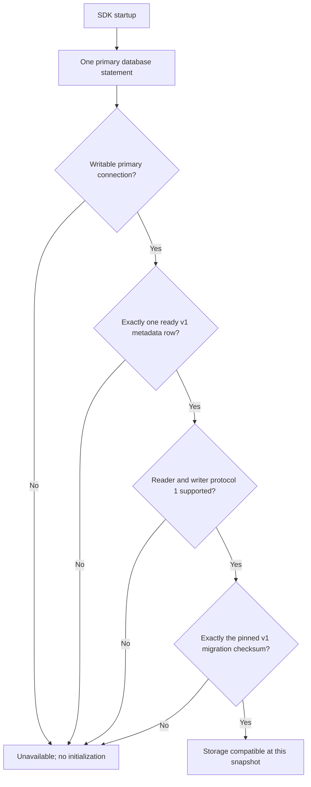

Both SDKs now have internal read-only PostgreSQL readiness checks against the bundled v1 storage policy. This advances #52 and the [[phase-3-postgres-records|record adapter checkpoint]]. Phase 3 remains open.

The helper uses a single SQL statement for metadata and ledger consistency. It requires a writable primary connection, one ready metadata row, database version 1, reader/writer ranges including protocol 1, and exactly one matching migration entry. The SHA-256 checksum is bundled in each SDK; actual catalog bytes supply the independent expected checksum in the integration tests. Supporting a new database version requires an explicit tested policy change.

Missing tables, absent metadata, changed checksums, ledger gaps, extra history, future database versions and incompatible protocols return unavailable. Caller cancellation and the five-second deadline retain their distinct errors. The helper executes no DDL and never treats absence as permission to initialize.

## Live proof

Run `heimdall-records-e272f15fc3fa4d0587501258c017f00b` passed on disposable pinned PostgreSQL 17.11. Both languages consumed the same eleven readiness scenarios in `contracts/fixtures/postgres-readiness.json`. Ready v1 and wider compatible protocol ranges succeeded; the nine incompatible/missing cases failed closed. Additional tests verified:

- A working connection configured read-only was rejected; the test first confirmed its actual database setting.
- A missing metadata table failed closed.
- An uncommitted incompatible metadata/ledger transaction left the prior ready snapshot visible. After commit, readiness rejected the incompatible state.
- Already cancelled calls performed no connection attempt.
- Existing encrypted record, concurrent CAS, cancellation and cross-language interoperability checks still passed after sharing TypeScript's query transport.

The harness removed its local container afterward. This does not claim a live streaming-replica test: replica detection uses PostgreSQL's recovery-state function; the live negative connection test covers read-only mode.

## Integration boundary

These are internal building blocks. The eventual public adapter factory must run readiness before returning session operations; the low-level record constructor does not yet do that composition. The deployment migration runner, database privilege/readiness completeness, session lifecycle, identity denial and audit transactions remain open.

A successful startup snapshot is not a migration lock or a permanent authorization to keep running. Deployment coordination must still drain incompatible readers/writers before a destructive change. The runtime helper never migrates, fences another process or repairs storage. The current check verifies metadata compatibility, not every table/index, runtime privilege or deployment topology assumption.
