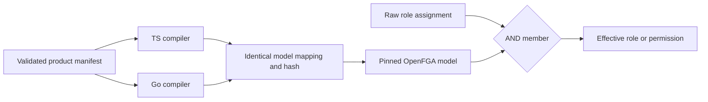

Phase 3 is in progress. Internal TypeScript and Go compilers now produce identical OpenFGA 1.1 models, role/permission mappings and SHA-256 model hashes from structurally validated manifests. This is the first implementation slice for #33, not completion of the PostgreSQL or SDK integration phases.

The shared contracts/fixtures/tenant-model-v1.json corpus contains Ledger and Support manifests with distinct permission sets, plus a declared Support permission with no granting role. Both language tests compare the entire generated model, mapping and hash with independent expected vectors, verify input ordering does not change output, and reject a missing owner role through existing manifest validation. Public SDK entry points remain unchanged.

Role assignments use r_N and effective roles e_N; permissions use p_N. Names are sorted before assigning ordinals. Every effective role and permission intersects its grants with member. An unassigned permission is explicitly false. Short generated relation names avoid product-name collisions with internal relations.

These ordinal mappings are valid only for their exact model/manifest pair. Adding or removing a name can reassign ordinals. A later provisioning workflow must migrate tuples and atomically activate the model/mapping binding; it must never reinterpret old tuples through a new mapping. The model hash identifies model JSON, not product authorization or a complete manifest digest. See policies/tenant-rbac/README.md for the deterministic encoding.

## Live validation scope

The tests/integration/tenant-model.mjs probe submits the exact fixture models that both language compilers reproduce. It checks all role/membership bit combinations, every effective role and declared permission, denial in another workspace, and a principal belonging to the other product. Removing membership while retaining every role tuple must deny all effective roles and permissions with HIGHER_CONSISTENCY. The probe deletes only its own stores and awaits every dispatched batch before cleanup.

A first attempt timed out establishing a connection at concurrency twelve; it is excluded from successful proof. The probe now bounds concurrency at four. This is not a throughput benchmark or SDK transport retry policy.

Ordinary role-grant authorization, owner restrictions, delegation enforcement, unknown-role runtime errors, model migration, durable audit and session integration are not implemented by this compiler. A trusted OpenFGA writer can directly write raw assignment relations; the later SDK administration path must enforce its own verified actor and delegation checks. Ticket #33 and Phase 3 remain open.

## Recorded result

Live run d56b8bf6-fbf4-4536-b3c6-2c7e450054a9 passed against the pinned Railway OpenFGA deployment: Ledger exercised 32 combinations and 330 checks; Support exercised 16 combinations and 153 checks. Both owned stores were deleted. Sanitized output is tests/integration/evidence/tenant-model-2026-11-11.json.

The full workspace gate passed with 865 Vitest tests, Go race tests, format/lint/types/Knip/vet, SDK build/declarations and 58 Quartz pages. No dependencies were added. This checkpoint does not close #33 or Phase 3.
