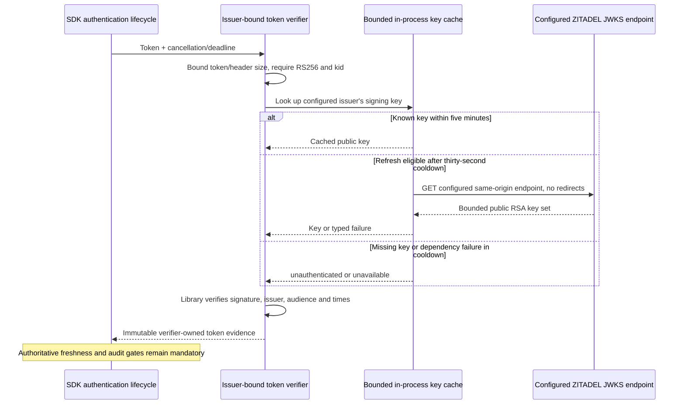

Both SDKs now have internal access-token signature verifiers backed by maintained JWT libraries. This supplies the cryptographic foundation for #34. It does **not** complete authentication: authoritative token/user status, human-versus-service identity checks, session invalidation and durable audit still need composition. Public SDK entry points remain unexported.

## Implemented boundaries

| Boundary | Current implementation |
| --- | --- |
| Trusted inputs | Constructor snapshots issuer, audience and JWKS URL; issuer and JWKS must share an origin |
| Untrusted token headers | Cannot override endpoints; jku is ignored; missing/invalid kid, other algorithms and critical extensions are rejected |
| Cryptography | RS256 through jose 6.2.12 in TS and golang-jwt/jwt v5.3.1 in Go; no hand-written signature verification |
| Claims | Exact issuer, required intended audience, nonempty canonical subject, required integer exp/iat, optional integer nbf; zero clock tolerance |
| Lifetime | Expiry is exclusive; future iat/nbf, absent timestamps and invalid ordering are rejected |
| Key retrieval | Same-origin configured URL, no redirects, five-second deadline, 256 KiB body limit, at most 16 public RSA keys |
| Key policy | Unique printable ASCII kids; RS256/signature/verify-only metadata when present; no private material; 2048–8192-bit RSA modulus |
| Cache | Five minutes from retrieval start; thirty-second refresh cooldown including failures; one shared fetch per verifier |
| Rotation/outage | Unknown key can trigger an eligible refresh; missing key after successful retrieval is unauthenticated; failed retrieval is unavailable; no stale-key fallback |
| Cached known keys | Can verify during a refresh outage only within their original cache lifetime; this never substitutes for authoritative identity freshness |
| Clock rollback | Invalidates cached-key use instead of extending cache validity |
| Cancellation | Each caller has a five-second bound or its earlier deadline; cancelling one waiter does not cancel the shared fetch for others; that fetch has its own five-second bound |
| Runtime evidence | TS freezes returned evidence and recognizes it through a verifier-local WeakSet; Go uses private immutable fields and a verifier owner reference; fabricated/cross-verifier evidence is rejected |
| Diagnostics | Typed errors omit raw tokens, credentials and provider exceptions |

The libraries meet the workspace's 30-day dependency age requirement. The TS version was published September 5, 2026; the Go version January 28, 2026. Frozen-lockfile installation passed. Source references: [jose verification API](https://github.com/panva/jose/blob/v6.2.12/docs/jwt/verify/functions/jwtVerify.md), [golang-jwt v5.3.1](https://pkg.go.dev/github.com/golang-jwt/jwt/v5@v5.3.1).

## Proof

Shared `contracts/fixtures/token-verification.json` contains synthetic signatures and public keys only. Both languages test valid and rotated keys, Unicode/NUL subjects, unpaired-surrogate rejection, forged signatures, wrong issuer/audience, expiry, future timestamps, missing claims, unknown keys, algorithm confusion and untrusted header URLs. Fault tests cover concurrent key fetches, refresh cooldowns, cache expiry during outage, recovery, malformed/private/oversized key sets, bounded HTTP responses, cancellation and real HTTP redirect/timeout behavior. Go tests run with the race detector.

Two live runs, `c64bb387-4775-40c5-a10e-815af8558bc3` and `fb6eb82d-86a8-4c97-a9a1-f90cc5f9affd`, passed against the pinned Railway ZITADEL instance. For **both Ledger and Support**, **both SDKs** accepted the valid product access token and rejected the other product audience, an unknown signing key and an untrusted signature claiming a trusted key ID. The broader code/PKCE, refresh, introspection, disable/delete and cleanup probe also passed. Sanitized evidence is committed in `tests/integration/evidence/token-verification-2026-11-11.json`.

The tested Railway ZITADEL 4.19.4 deployment `7ef5c76d-4911-4326-97dc-50d5614f2a55` was confirmed SUCCESS. The full workspace gate passed with 910 TS tests, Go race tests, lint/types/Knip, SDK builds and 69 Quartz pages.

The existing OIDC probe now optionally runs the actual SDK tests with `HEIMDALL_PROBE_SDK_IDENTITY=1`. Tokens reach child tests only through inherited process environment and are never written to the evidence files. Each language retrieves the provider's configured JWKS endpoint itself. This extends the older probe's test-only cryptographic assertions rather than treating those assertions as SDK proof.

The initial live attempt `7469d173-6111-4fb4-a8b5-6240749e63f9` failed its TS child assertion. Cleanup ran, but the child error code was not retained, so its cause is unclassified. The probe now emits only allowlisted error codes and source locations on failure. Passing subsequent samples do not establish an availability or revocation SLA.

## Remaining gates

The returned value proves a signed issuer/subject token, not a currently active human identity. #34 remains open until authoritative status and bounded positive freshness, public factory/configuration, principal enforcement and cancellation/redaction integration are proven. Session middleware, refresh/logout and audited authorization belong to the later integration phase. This checkpoint does not advance beyond Phase 3.

Discovery is not fetched by this primitive; setup must validate and pin the issuer's JWKS URL. RSA-only/key-count limits deliberately reject an unsupported provider rollout. Operators must maintain accurate clocks for zero-tolerance claim checks. Key removal can take up to the cache lifetime to affect local signature validation; the separate maximum-60-second identity-status gate remains required.
